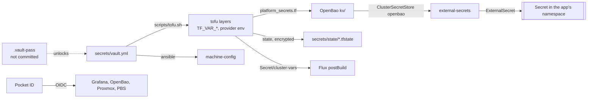

# Access & secrets

Three things decide who gets in and what a workload knows:

- **Pocket ID** -- SSO for people, passkeys only. An extra way in, never the
  only one: every system keeps a local login as [break-glass](#break-glass).
- **`secrets/vault.yml`** -- the ansible vault. Bootstraps the lab: every
  credential a tofu layer or Ansible needs, and the values tofu copies into
  OpenBao.
- **OpenBao + external-secrets** -- what workloads read. Filled by tofu from
  the vault (or generated by tofu), handed to pods as Kubernetes Secrets.



## Logging in: Pocket ID {#sso}

`https://login.<app_domain>`, LAN and tailnet. No signups, no SMTP: an admin
creates the user and sends a one-time link, the user enrolls a passkey.
Details, users, groups and recovery: [Pocket ID](platform/pocket-id.md).

| Group | Means |
|--|--|
| `admins` | admin wherever a client maps the group |
| `household` | everyone else |

| Uses Pocket ID | How the group maps |
|--|--|
| Grafana | `admins` -> Admin, anyone else -> Viewer; anonymous is Viewer anyway |
| OpenBao | `admins` only, policy `admin`, 8h token |
| Proxmox | `admins` -> group `admins-pocket-id`, Administrator; rights re-read every login |
| PBS | no group mapping: each admin is created by hand as `<name>@pocket-id` |

No SSO: TrueNAS (no OIDC), Vaultwarden (deliberately -- see
[Vaultwarden](workloads/vaultwarden.md#not-enabled)), Syncthing, Kassenbuch,
Home Assistant. Glance, Supplement tracker and Alertmanager have no login at
all: being on the LAN or tailnet is the access control.

## Break-glass {#break-glass}

When Pocket ID or the SSO path is down. Each page has the details; this is
where to find the credential.

| System | Normal login | Break-glass | Credential lives |
|--|--|--|--|
| [Proxmox](platform/proxmox.md) | Pocket ID realm | `root@pam` | root password, not in the repo -- the password managers |
| [PBS](platform/pbs.md) | `<name>@pocket-id` | `root@pam` | root password, not in the repo -- the password managers |
| [TrueNAS](platform/truenas.md) | `admin` (local) | `truenas_admin` | not in the repo -- the password managers |
| [OpenBao](platform/openbao.md) | Pocket ID OIDC | root token | `bao_root_token` in `secrets/vault.yml`; recovery keys in the password managers |
| [Grafana](monitoring.md#access) | Pocket ID | the admin form | `kv/monitoring/grafana`, generated by tofu |
| [Pocket ID](platform/pocket-id.md) | passkey | one-time link from `kubectl exec` | the cluster |
| [Vaultwarden](workloads/vaultwarden.md) | master password + passkey | `/admin` token | plaintext in the password managers; hash `vaultwarden_admin_token_hash` |
| [Syncthing](workloads/syncthing.md) | GUI user `admin` | -- | `kv/syncthing/app`, generated by tofu |
| [Kassenbuch](workloads/kassenbuch.md) | shared password | -- | plaintext in the password managers; hash `kassenbuch_password_hash` |
| [Zot](platform/zot.md) | anonymous pull | user `push` | `kv/zot/registry`, generated by tofu |
| [Home Assistant](workloads/home-assistant.md) | own users | -- | the password managers |
| Kubernetes | `secrets/kubeconfig` | `secrets/talosconfig` | both regenerated by `mise run cluster apply` |
| VMs (ssh) | `secrets/guests-ssh-key` | Proxmox console | regenerated by `mise run guests apply` |
| Garage | per-bucket keys | `garage_admin_token` | `secrets/vault.yml` |
| UniFi, Cloudflare, GitHub | vendor login | -- | not in the repo |
| Tailscale admin console | GitHub login | -- | GitHub |

Reading a generated value without OpenBao: the Secret ESO made from it.

```sh
kubectl -n monitoring get secret grafana-admin -o jsonpath='{.data.admin-user}' | base64 -d
kubectl -n monitoring get secret grafana-admin -o jsonpath='{.data.admin-password}' | base64 -d
kubectl -n syncthing get secret syncthing -o jsonpath='{.data.gui-password}' | base64 -d
```

Second copies of every break-glass credential above, `.vault-pass` and the
ZFS pool passphrase are kept in several password managers -- not only the
lab's Vaultwarden, so a lab outage does not lock them away.

## The vault: `secrets/` {#vault}

`secrets/` is a submodule, and the repo behind it (`Sojamann/homelab-secrets`)
is private. Nothing encrypted is committed to the public repo. Only the
template is public:

| File | Where | Purpose |
|--|--|--|
| `secrets.example.yml` | repo root | template for `vault.yml`, with a comment per key -- what this lab needs to run |

The rest lives in the submodule:

| File | Committed | Purpose |
|--|--|--|
| `.vault-pass` | no | the ansible-vault password, unlocks the two encrypted files below |
| `vault.yml` | yes, encrypted | the one hand-written secret file: private variables, tokens, passwords |
| `proxmox-token.yml` | yes, encrypted | Proxmox API token, written and encrypted by the machine-config stage |
| `state/<layer>.tfstate` | yes, encrypted | every layer's OpenTofu state -- the `backend` block in each layer argues why it is in git at all |
| `guests-ssh-key` | no | ssh key with the initial trust to the guests, written by the guests layer |
| `talosconfig` | no | talosctl credentials, written by the cluster layer |
| `kubeconfig` | no | kubectl credentials, written by the cluster layer |

Uncommitted files are regenerated by running the tofu layer that writes them.
`.vault-pass` is the exception: it is the one thing that cannot be rebuilt;
its second copy is in the password managers.

The state is encrypted with `terraform_state_passphrase`, which is inside the
vault. So **the vault password unlocks everything**, history included -- and
losing it loses everything. How this repo is backed up and restored:
[Secrets repo](backups.md#secrets-repo).

### Editing

```sh
ansible-vault edit secrets/vault.yml      # values unquoted
```

A new key: add it to `secrets.example.yml` too, with a comment saying what it
is and where it comes from. `mise run <layer>` refuses to start when a key it
needs is missing and names it.

### How they reach a stage

`scripts/tofu.sh <layer>` decrypts what that layer needs and exports it as
`TF_VAR_*` or provider env vars, then runs tofu. Nothing is written to disk in
clear. Each stage doc lists its variables (e.g.
[platform](build/platform/README.md#credentials)).

### Committing across both repos {#committing-across-both-repos}

A `tofu apply` changes two repos: the layer here, and the state in `secrets/`.
Stage what you changed and let one task close both:

```sh
git add cluster/
mise run save "cluster: a second control plane"
git push                                    # carries the submodule commits along
```

It commits the submodule first (the pointer cannot exist before the commit it
points at), commits here, and then attaches a `git note` to the submodule
commit naming this one (`git -C secrets log --notes`). A commit is a backup
only once pushed.

## OpenBao and external-secrets {#openbao}

The vault only bootstraps the lab. Everything a *workload* needs lives in
OpenBao, in the `kv` v2 mount, and reaches pods through external-secrets: an
`ExternalSecret` names a path, the `openbao` ClusterSecretStore reads it
(read-only, authenticating with its own ServiceAccount token) and
materialises a Secret. PushSecret is off: nothing in the cluster writes back.

Component internals (seal, auth, first install): [OpenBao](platform/openbao.md).

**Every value is tofu's.** `platform/platform_secrets.tf` writes the whole
tree: copied from the vault, or generated with `random_password`. The tree is
`kv/<namespace>/<app>`:

| Path | Holds | Source |
|--|--|--|
| `kv/monitoring/grafana` | Grafana admin | generated |
| `kv/monitoring/grafana-oidc` | Grafana's Pocket ID client | vault |
| `kv/monitoring/alerting` | Telegram bot token, heartbeat URL | vault |
| `kv/monitoring/garage` | Garage metrics token | vault |
| `kv/kassenbuch/app` | password hash | vault |
| `kv/pocket-id/app` | encryption key | generated |
| `kv/vaultwarden/app` | admin token hash | vault |
| `kv/syncthing/app` | GUI password, API key | generated |
| `kv/volsync/restic` | Garage key, restic password | vault |
| `kv/tailscale/operator` | operator OAuth client | vault |
| `kv/dhs/backup` | DHS postgres backup role | vault |
| `kv/zot/registry` | push password, htpasswd | generated |

So the encrypted tofu state is OpenBao's backup: losing its volume costs a
re-initialise and `mise run platform apply`, not a reconstruction.

### Adding a secret for a workload

1. If it comes from outside: add the key to `secrets/vault.yml` and
   `secrets.example.yml`, and to the platform branch of `scripts/tofu.sh`.
2. Add a `vault_kv_secret_v2` at `kv/<ns>/<app>` in `platform_secrets.tf`
   (`random_password` beside it if tofu should generate it).
3. `mise run platform apply`, then `mise run save "<msg>"`.
4. In `flux/apps/<app>/`, an `ExternalSecret` with
   `secretStoreRef: { kind: ClusterSecretStore, name: openbao }` and
   `remoteRef.key: <ns>/<app>`.

### Rotating

Change the value at its source (vault, or `tofu taint` the `random_password`),
`mise run platform apply`, then make the app see it -- ESO refreshes hourly,
and most apps read env only at start:

```sh
kubectl -n <ns> annotate externalsecret <name> force-sync=$(date +%s) --overwrite
kubectl -n <ns> rollout restart deploy/<name>
```

Worked example: [Vaultwarden admin token](workloads/vaultwarden.md#admin-token).

## What breaks without it

- **Pocket ID down** -- SSO logins fail; every break-glass above still works.
  Running sessions continue until they expire.
- **OpenBao down** -- no new or rotated Secrets; existing Secrets stay, so
  running and restarting pods are fine. A new namespace's `ExternalSecret`
  stays unsynced.
- **external-secrets down** -- same as OpenBao down.
- **`.vault-pass` lost** -- no tofu layer, no Ansible, no state; see
  [Secrets repo](backups.md#secrets-repo).

## Gotchas

- **ESO reads the whole tree.** Anything that can create an `ExternalSecret`
  in any namespace can read any secret.
- **The root token is the root token**, kept in the vault because
  `scripts/tofu.sh` configures OpenBao with it. People use Pocket ID.
- **Re-initialising OpenBao** issues a new root token: put it in the vault as
  `bao_root_token` before the next `mise run platform apply`.
- **One Cloudflare token, two consumers** -- Proxmox's ACME plugin and
  cert-manager. Rotating it is two places.
