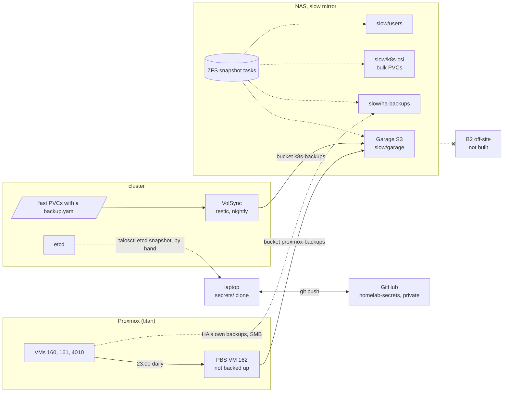

# Backups & restore

Every backup in the lab lands on one box: the NAS's `slow` mirror. Off-site
is not built, so the NAS is the single place everything is lost at once --
see [Not covered](#not-covered).



## Coverage matrix

What each route holds, with retention. ✓ covered, ✗ not covered, n/a the
route cannot apply. *Other* lists the incidental copies under
[Other copies](#other-copies).

| What | [ZFS](#zfs-snapshots) | [PBS](#pbs) | [HA own](#ha-backups) | [VolSync](#volsync) | [Secrets repo](#secrets-repo) | [etcd](#etcd-snapshots) | [Off-site](#off-site) | Other |
|--|--|--|--|--|--|--|--|--|
| **Vaultwarden** (`vaultwarden-data`, fast) | ✗ | n/a | n/a | ✓ d14 w8 m6 | admin token hash | n/a | ✗ | clients' offline cache, items only |
| **Syncthing** files (`slow/k8s-csi/syncthing`) | ✓ 24 hourly + 30 daily | n/a | n/a | ✗ | n/a | n/a | ✗ | trash can 7d; every paired device |
| **Syncthing** config + keys (`syncthing-config`, fast) | ✗ | n/a | n/a | ✓ d14 w8 m6 | n/a | n/a | ✗ | |
| **DHS** postgres (external Hetzner box) | n/a | n/a | n/a | ✓ d14 w8 m6, via the nightly dump | backup role password | n/a | ✗ | last dump on `postgres-dump` |
| **Kassenbuch** (`kassenbuch-data`, bulk) | ✓ 24 hourly + 30 daily | n/a | n/a | ✗ | password hash | n/a | ✗ | |
| **Supplement tracker** (bulk) | ✓ 24 hourly + 30 daily | n/a | n/a | ✗ | n/a | n/a | ✗ | |
| **Glance** | n/a | n/a | n/a | n/a | n/a | n/a | n/a | stateless, config in git |
| **Home Assistant** (VM 161) | n/a | ✓ last 3, d7 w4 m6 | ✓ schedule in the appliance | n/a | n/a | n/a | ✗ | |
| **Pocket ID** (`pocket-id-state`, fast) | ✗ | n/a | n/a | ✓ d14 w8 m6 | encryption key (tofu state) | n/a | ✗ | |
| **OpenBao** (`data-openbao-0`, fast) | ✗ | n/a | n/a | ✗ | ✓ every value + seal key | n/a | ✗ | `bao operator raft snapshot`, by hand |
| **Zot** (`zot-data`, bulk) | ✓ 24 hourly + 30 daily | n/a | n/a | ✗ | n/a | n/a | ✗ | rebuildable from source |
| **Prometheus, Alertmanager** (fast) | ✗ | n/a | n/a | ✗ | n/a | n/a | ✗ | history only, not kept |
| **VPN VM** (160) | n/a | ✓ last 3, d7 w4 m6 | n/a | n/a | n/a | n/a | ✗ | |
| **Talos VM** (4010) | n/a | ✓ last 3, d7 w4 m6 | n/a | n/a | machine secrets (tofu state) | ✓ by hand, no schedule | ✗ | |
| **PBS VM** (162) | n/a | ✗ excluded | n/a | n/a | n/a | n/a | ✗ | rebuilt by hand |
| **Cluster objects** | n/a | via the Talos VM | n/a | n/a | ✓ tofu state | ✓ by hand | ✗ | flux/ in git |
| `slow/users/*/files` | ✓ 24 hourly + 30 daily | n/a | n/a | n/a | n/a | n/a | ✗ first in line | |
| `slow/users/*/time-machine` | ✗ by design | n/a | n/a | n/a | n/a | n/a | ✗ | the Mac is the original |
| `slow/garage` (every S3 backup) | ✓ 7 daily | n/a | n/a | n/a | n/a | n/a | ✗ | Garage metadata snapshot 6h |
| `slow/ha-backups` | ✓ 14 daily | n/a | n/a | n/a | n/a | n/a | ✗ | |
| `slow/node-exporter` | ✗ nothing to keep | n/a | n/a | n/a | n/a | n/a | n/a | |
| `fast` pool itself | ✗ by design | n/a | n/a | the PVCs above | n/a | n/a | ✗ | |
| TrueNAS config | ✗ | n/a | n/a | n/a | n/a | n/a | ✗ | none documented |
| Proxmox host config (`/etc/pve`) | n/a | ✗ | n/a | n/a | API token | n/a | ✗ | rebuilt by machine-config + manual steps |
| `vault.yml`, tofu state | n/a | n/a | n/a | n/a | ✓ full git history | n/a | GitHub | every clone |
| `.vault-pass` | n/a | n/a | n/a | n/a | ✗ not committed | n/a | ✗ | not documented |

## Scenario index

| This broke | Go to |
|--|--|
| A file deleted or overwritten on a NAS share | [ZFS snapshots](#zfs-snapshots) |
| A file deleted in Syncthing | [Syncthing](workloads/syncthing.md) first (trash can, 7d), then [ZFS snapshots](#zfs-snapshots) |
| A PVC deleted | `fast`: [VolSync](#volsync), if it has a `backup.yaml`, else rebuild. `bulk`: [ZFS snapshots](#zfs-snapshots) -- the driver deletes the directory, the snapshots still hold it for 30 days |
| A dead or broken VM | [PBS](#pbs). Home Assistant also: [its own backups](#ha-backups) |
| Dead Proxmox node (titan, the only one) | [PBS](#pbs), *Dead node*: PBS first, then the VMs from it, then tofu |
| Dead `fast` NVMe on the NAS | [VolSync](#volsync), *Lost `fast` pool* |
| Lost cluster | [Recover from zero](recover-from-zero.md); the Talos VM from [PBS](#pbs), or rebuild and [VolSync](#volsync); [etcd](#etcd-snapshots) only if a snapshot exists |
| Dead NAS | [Not covered](#not-covered) |
| Lost laptop, or lost vault password | [Secrets repo](#secrets-repo) |

## ZFS snapshots {#zfs-snapshots}

**How it works.** Periodic snapshot tasks on the NAS (*Data Protection* ->
*Periodic Snapshot Tasks*). Copy-on-write, same pool: undo for mistakes, no
protection against losing the pool. Built in
[machines/truenas.md](build/machines/truenas.md#creating-datasets).

**Schedule / retention.**

| Dataset | Task | Keeps |
|--|--|--|
| `slow/k8s-csi` | hourly + daily, not recursive (PVs are directories) | 24h + 30d |
| `slow/users` | hourly + daily, recursive, excludes `slow/users/*/time-machine` | 24h + 30d |
| `slow/garage` | daily, recursive (`meta` and `data` stay consistent) | 7d |
| `slow/ha-backups` | daily | 14d |
| `slow/node-exporter`, `time-machine`, `fast` | none | -- |

Why the gaps:

- `fast` -- democratic-csi owns it. A snapshot it does not know about blocks
  the zvol destroy behind a PVC (stuck `Terminating`), and it would die with
  the drive anyway. VolSync covers it instead.
- `time-machine` -- a snapshot pins the bands TM deletes; it grows forever.
- `garage` short -- snapshots pin the blocks PBS GC frees. Kept at all because
  Garage has no object lock: this is what survives a client deleting its own
  bucket.

**Credentials.** The NAS UI login; see [TrueNAS](platform/truenas.md).

**Health check.** Nothing in Prometheus; TrueNAS's own alerts go to
Telegram (set up in the UI, not in this repo). In the UI, the task list
shows the last run. Or in a NAS shell (UI *System* -> *Shell*):

```sh
zfs list -t snapshot -o name,creation -s creation slow/users | tail -3
zfs list -t snapshot -o name,creation -s creation slow/k8s-csi | tail -3
```

**Restore.** Snapshots are browsable read-only under `.zfs/snapshot/` in the
dataset's mountpoint. Copy out what you need:

```sh
ls /mnt/slow/users/<name>/files/.zfs/snapshot/
cp -a /mnt/slow/users/<name>/files/.zfs/snapshot/<snap>/<path> /mnt/slow/users/<name>/files/<path>
```

A `bulk` PVC is a directory under `slow/k8s-csi` (`pvc-<uuid>`, or
`syncthing/`). Scale the app to 0 first, copy back, scale up. A recreated PVC
gets a new directory -- copy into that one.

Rolling a whole dataset back (`zfs rollback -r`) destroys every newer
snapshot. On `slow/garage` it also rolls back every bucket: for one bucket,
`zfs clone` the snapshot and copy out instead.

**Last verified:** never.

## PBS on Garage {#pbs}

**How it works.** A PVE backup job sends every VM except PBS itself to the PBS
VM (162), whose datastore `proxmox-backups` is an S3 datastore in Garage
(bucket `proxmox-backups`, quota 300G) with a local cache disk. Incremental,
deduplicated, per-VM and per-file restore. Built in
[guests/README.md](build/guests/README.md#backups); the component is
[Proxmox Backup Server](platform/pbs.md).

PBS is excluded from its own job: it cannot restore itself, and it would back
up its own chunk store. Its configuration is therefore not backed up.

Backups are **not client-side encrypted**: the PVE storage entry `pbs-s3` has
no encryption key (`/etc/pve/priv/storage/` holds only `pbs-s3.pw`). Anyone
with the Garage key reads every VM disk.

**Schedule / retention.** The order matters -- prune must count the backup
before it, and GC is the expensive one.

| Job | Where | Schedule |
|--|--|--|
| Backup | PVE, *Datacenter* -> *Backup*, mode snapshot, all VMs, exclude 162 | `23:00` daily |
| Prune | PBS datastore | `04:00` daily: keep last 3, daily 7, weekly 4, monthly 6 |
| GC | PBS datastore | `sun 05:00` |
| Verify | PBS datastore | `sat 22:00`, skip verified |

PVE's own retention on the job is `keep-all`: pruning is PBS's alone.

**Credentials.**

| What | Where |
|--|--|
| PBS -> Garage | `garage_pbs_key_id` / `garage_pbs_secret_key` in `secrets/vault.yml` |
| PVE -> PBS | token `backup@pbs!lab` (DatastoreBackup), stored in `/etc/pve/priv/storage/pbs-s3.pw` |
| PBS UI | Pocket ID; `root@pam` break-glass |

**Health check.** Nothing in Prometheus. The job notifies on failure through
PVE's notification system, to Telegram (set up in the UI, not in this repo).
In the UI: PBS -> *Datastore* -> `proxmox-backups` -> *Content* (last
snapshot per VM, verify state). On titan:

```sh
pvesm list pbs-s3 | tail
```

**Restore a VM.** UI: VM -> *Backup* -> pick -> *Restore*. Or on titan:

```sh
pvesm list pbs-s3 --vmid <id>
qm stop <id>                                                  # if it still exists
qmrestore pbs-s3:backup/vm/<id>/<timestamp> <id> --storage local --force 1
```

Single files: *Storage* `pbs-s3` -> *Backups* -> *File Restore*.

**Dead node.** titan is the only node, so PBS dies with it; the backups are
in Garage.

1. Reinstall the node ([machines/proxmox.md](build/machines/proxmox.md)),
   then `mise run machine-config`.
2. Only the PBS VM: `mise run guests apply -target=proxmox_virtual_environment_vm.pbs`.
   **Not** a full `guests apply` -- that would create the other VMs empty
   under the IDs the restores need.
3. Install PBS and re-add the S3 endpoint and datastore on the existing
   bucket, token, storage entry and jobs per
   [guests/README.md](build/guests/README.md#backups).
4. Restore the VMs as above.
5. `mise run guests plan` -- should now be close to a no-op.

**Restoring the Talos VM** rolls etcd back to 23:00 of that day. PVCs live on
the NAS, so anything created after that is an orphan on `fast` and anything
deleted after it is a PV pointing at nothing.

**Last verified:** never. The datastore move (iSCSI -> S3) lists a restore
test as a step, but no result is recorded.

## Home Assistant's own backups {#ha-backups}

**How it works.** Home Assistant writes its own backups to the NAS share
`ha-backups` (dataset `slow/ha-backups`, with a quota) over SMB, as the
`ha-backup` service account. Application-level: restores a configuration into
a running Home Assistant, and survives PBS. Scheduled and encrypted inside the
appliance, not in this repo.

**Schedule / retention.** In Home Assistant: *Settings* -> *System* ->
*Backups*. Not recorded here. On top, the ZFS task on `slow/ha-backups` keeps
14 daily snapshots.

**Credentials.** The `ha-backup` SMB password, and Home Assistant's backup
encryption key. Without the key the backups are unreadable.

**Health check.** Nothing alerts. *Settings* -> *System* -> *Backups* shows the
last successful one; the share shows the files.

**Restore.** Into a running instance: *Settings* -> *System* -> *Backups* ->
pick -> *Restore*. Into a fresh one (e.g. a VM rebuilt from the image): copy
the `.tar` off the share, choose *Upload backup* at onboarding, give the key.
App specifics: [Home Assistant](workloads/home-assistant.md).

**Last verified:** never.

## VolSync on Garage {#volsync}

**How it works.** restic, nightly, for the `fast` PVCs that cannot be rebuilt.
`fast` is one unmirrored NVMe and a ZFS snapshot there dies with the zvol --
`kubectl delete pvc` included. Each PVC gets a `backup.yaml` beside it: an
`ExternalSecret` with the restic repository and keys, and a
`ReplicationSource`. Wiring: [volsync.md](build/flux/docs/volsync.md).

| PVC | Namespace | Schedule (UTC) | Defined in (apps repo) | Mover uid |
|--|--|--|--|--|
| `vaultwarden-data` | `vaultwarden` | `00:15` | `apps/vaultwarden/backup.yaml` | 1000 |
| `syncthing-config` | `syncthing` | `00:30` | `apps/syncthing/backup.yaml` | 1000 |
| `pocket-id-state` | `pocket-id` | `00:45` | `infrastructure/configs/pocket-id/backup.yaml` | 1000 |
| `postgres-dump` | `dhs` | `01:00` | `apps/dhs/backup.yaml` | 70 |

`postgres-dump` holds a `pg_dump -Fc` of the DHS box, written by a CronJob at
`00:30` (`apps/dhs/dump.yaml`) and alerted on by `DhsDumpStale` -- see
[DHS](workloads/dhs.md).

Deliberately not backed up: OpenBao (tofu rebuilds its contents), Prometheus
and Alertmanager (history only), and `bulk` (on the mirror, under ZFS
snapshots). A new `fast` PVC that cannot be rebuilt gets a `backup.yaml`.

A run: the controller clones the PVC, runs restic `backup` then `forget` in
a Job in the app's namespace, and deletes the clone and the Job. The
repository is initialised on the first run; the first run starts at creation,
not at the schedule.

Resource diagram and why `Clone`, not `Snapshot`:
[volsync.md](build/flux/docs/volsync.md).

The copy is crash-consistent. SQLite fsyncs its commits, the DHS dump is
written aside, synced and renamed. Anything that does not fsync can lose what
was still in the page cache -- the drill caught a freshly written file going
in as 0 bytes.

**Schedule / retention.** Daily per the table. `retain: daily 14, weekly 8,
monthly 6`; `prune` every 7 days. Bucket `k8s-backups`, quota 50G.

**Credentials.** One Garage key (`volsync`) and one restic password for every
repository: `garage_volsync_key_id`, `garage_volsync_secret_key`,
`volsync_restic_password` in `secrets/vault.yml`, written by
`platform_secrets.tf` to `kv/volsync/restic`.

- **Losing the restic password makes every backup unreadable.**
- Anything that can read one app's restic Secret can delete every app's
  backups. The 7-day ZFS snapshot on `slow/garage` is what survives that.

**Health check.**

```sh
kubectl get replicationsource -A        # every LAST SYNC within a day
kubectl -n <ns> get replicationsource <pvc> -o jsonpath='{.status.latestMoverStatus.logs}'
mise run s3 volsync ls --summarize --human-readable --recursive s3://k8s-backups/   # well under 50G
```

Alerts (warning, to Telegram -- see [Monitoring](monitoring.md)):
`VolSyncBackupFailing` (a source out of sync for 1h) and
`VolSyncMetricsAbsent` (no sync status at all: controller or scrape dead).

**Restore.** Into the app's PVC with `copyMethod: Direct` -- overwritten in
place. Never through a volume populator: that restores
via a VolumeSnapshot and fails like `Snapshot` above. The workload page gives
the values for its app:

```sh
NS=vaultwarden KS=vaultwarden DEPLOY=vaultwarden PVC=vaultwarden-data MOVER_UID=1000
```

1. Stop the app so Flux does not scale it back up. Pocket ID's Kustomization
   is `infrastructure`, which suspends every controller with it.
   ```sh
   flux suspend kustomization "$KS"
   kubectl -n "$NS" scale deploy/"$DEPLOY" --replicas=0
   ```
2. If the PVC is gone, create it empty first: `kubectl apply -f` the app's
   `storage.yaml` from `flux/`. Then:
   ```sh
   kubectl apply -f - <<EOF
   apiVersion: volsync.backube/v1alpha1
   kind: ReplicationDestination
   metadata:
     name: $PVC
     namespace: $NS
   spec:
     trigger: { manual: restore-1 }
     restic:
       repository: $PVC-restic
       copyMethod: Direct
       destinationPVC: $PVC
       # restoreAsOf: "2026-10-30T00:00:00Z"   # older than the latest
       moverSecurityContext:
         runAsNonRoot: true
         runAsUser: $MOVER_UID
         runAsGroup: $MOVER_UID
         fsGroup: $MOVER_UID
         seccompProfile: { type: RuntimeDefault }
   EOF
   ```
3. Wait until it reports `restore-1`, then read the mover's log:
   ```sh
   kubectl -n "$NS" get replicationdestination "$PVC" -o jsonpath='{.status.lastManualSync}'
   kubectl -n "$NS" get replicationdestination "$PVC" -o jsonpath='{.status.latestMoverStatus}'
   ```
4. Clean up (its cache PVC goes with it) and start the app:
   ```sh
   kubectl -n "$NS" delete replicationdestination "$PVC"
   flux resume kustomization "$KS"
   ```

> [!WARNING]
> **A new ReplicationSource backs up at once**, not at its first schedule
> tick: VolSync starts a sync whenever `status.lastSyncTime` is unset,
> whatever the trigger. On a rebuilt cluster that is the fresh, empty PVC,
> which becomes restic's `latest` -- restore with `restoreAsOf` older than
> the rebuild. See [Recover from zero](recover-from-zero.md#stage-7-and-8-on-a-fresh-cluster).
> An existing ReplicationSource over a recreated empty PVC waits for its
> schedule: restore before then.

**Without the cluster.** Each repository is plain restic. From the repo root,
on Trusted or the tailnet (restic is not pinned in `mise.toml`):

```sh
. scripts/lib.sh
export RESTIC_REPOSITORY="s3:https://s3.<lab_domain>:3900/k8s-backups/$NS/$PVC"
export RESTIC_PASSWORD="$(vault_require secrets/vault.yml volsync_restic_password)"
export AWS_ACCESS_KEY_ID="$(vault_require secrets/vault.yml garage_volsync_key_id)"
export AWS_SECRET_ACCESS_KEY="$(vault_require secrets/vault.yml garage_volsync_secret_key)"
export AWS_DEFAULT_REGION=lab
restic snapshots
restic restore latest --target ./restore
```

**Lost `fast` pool.** Replace the NVMe and recreate the pool per
[machines/truenas.md](build/machines/truenas.md#creating-pools). Every `fast`
PV now points at nothing: delete the PVCs, let Flux recreate them empty, then
restore each row of the table above. OpenBao is re-initialised per
[platform/README.md](build/platform/README.md#first-install) and refilled by
`mise run platform apply`. Prometheus history is gone.

**Removing an app.** Its ReplicationSource goes with it; the repository
stays, on purpose -- it is the undo for a deleted PVC. Once the app is gone
for good:

```sh
mise run s3 volsync rm --recursive --dryrun s3://k8s-backups/<ns>/<pvc>/
mise run s3 volsync rm --recursive s3://k8s-backups/<ns>/<pvc>/
```

**Gotchas.**

- Changing `copyMethod` mid-run leaves the old run's Job, `volsync-*-src`
  PVC and VolumeSnapshot behind, and the next run reuses them. Delete all
  three; VolSync recreates what it needs.
- The cache PVC (`volsync-src-<pvc>-cache`) lives as long as the
  ReplicationSource. It is not data.

**Drill.** In a throwaway `volsync-drill` namespace: write 10 MiB plus its
`sha256` into a `fast` PVC, `sync`, back it up with `trigger.manual`
(repository `k8s-backups/volsync-drill/drill-data`), delete the PVC, restore
with `Direct` into a new empty PVC, `sha256sum -c`. Afterwards delete the
namespace and the `s3://k8s-backups/volsync-drill/` prefix as above.

**Last verified:** 2026-10-20, the drill above at rollout (mechanism only, no
real app). DHS's dump: 2026-10-27, restored from restic into a throwaway
postgres (12 tables, clean) -- not onto the box.

## Secrets repo {#secrets-repo}

**How it works.** `secrets/` is a submodule backed by the private GitHub repo
`Sojamann/homelab-secrets`. It holds everything the lab is built from that
cannot be public, encrypted:

| File | Committed | Unlocked by |
|--|--|--|
| `vault.yml` | yes, ansible-vault | `.vault-pass` |
| `proxmox-token.yml` | yes, ansible-vault | `.vault-pass` |
| `state/<layer>.tfstate` | yes, OpenTofu state encryption | `terraform_state_passphrase`, inside `vault.yml` |
| `.vault-pass` | **no** | -- |
| `guests-ssh-key`, `talosconfig`, `kubeconfig` | no | regenerated by their tofu layer |

The tofu state is the backup for everything tofu generated: Talos and
Kubernetes CAs, the OpenBao seal key, Pocket ID's encryption key and every
OpenBao value. Git history keeps every earlier version. Details:
[Access & secrets](access.md).

**Schedule / retention.** Every `mise run save`, kept forever. A commit is a
backup only once pushed: `mise run save` commits, `git push` carries the
submodule along.

**Credentials.** The `.vault-pass` file, and a GitHub login with access to
the private repo. **Losing the vault password makes the vault and every
state unreadable**, history included -- the passphrase is inside the vault.

**Health check.**

```sh
git -C secrets status -sb      # "ahead" means not on GitHub yet
git status -sb
```

**Restore** (lost laptop):

```sh
git clone --recurse-submodules git@github.com:Sojamann/homelab.git
cd homelab
# put the vault password at secrets/.vault-pass, mode 0600
mise run cluster plan    # proves vault + state decrypt
# talosconfig/kubeconfig come back with the next `mise run cluster apply`
```

**Last verified:** never from a fresh clone. Decryption itself runs on every
`mise run <layer>`.

## etcd snapshots {#etcd-snapshots}

**How it works.** By hand, before a Talos or Kubernetes upgrade (see
[Maintenance](maintenance.md)). The file lands wherever you ran the command.
Not scheduled, not kept anywhere in particular. The cluster is mostly
rebuildable without it: tofu state + the apps repo + VolSync.

```sh
talosctl -n talos-cp-1.<lab_domain> etcd snapshot ./etcd-$(date +%F).snapshot
```

**Credentials.** `secrets/talosconfig`. The snapshot itself contains every
Kubernetes Secret in clear: keep it out of the repo.

**Restore.** Onto a control plane whose etcd is not yet bootstrapped:

```sh
talosctl -n talos-cp-1.<lab_domain> bootstrap --recover-from=./etcd-<date>.snapshot
```

The cluster layer bootstraps etcd itself on apply, so this has to happen
before that resource runs. Untested here; upstream:
[Talos disaster recovery](https://www.talos.dev/latest/advanced/disaster-recovery/).

**Last verified:** never.

## Off-site (B2) {#off-site}

**Not built.** Intended: Backblaze B2, `users/` first.
Until it exists, losing the NAS loses every backup on this page.

**Last verified:** n/a.

## Other copies {#other-copies}

Not routes you plan around, but they exist:

- **Syncthing** -- each folder keeps a 7-day trash can (`.stversions/`), and
  every paired device holds the files. See [Syncthing](workloads/syncthing.md).
- **Vaultwarden clients** -- every logged-in client caches the vault items
  (not attachments or Sends). See [Vaultwarden](workloads/vaultwarden.md).
- **Garage metadata** -- Garage snapshots its LMDB every 6h inside
  `slow/garage/meta`, against metadata corruption. Same dataset, so no
  protection from losing it.
- **OpenBao raft** -- `bao operator raft snapshot save` before anything
  destructive. By hand; its contents are rebuilt by tofu anyway. See
  [OpenBao](platform/openbao.md).
- **DHS** -- the last dump stays on `postgres-dump` until the next run.

## Not covered {#not-covered}

- **The NAS.** Fire, theft, both HDDs, or a corrupt `slow` pool takes the
  `bulk` data, the user files, Garage (all PBS and VolSync backups), the HA
  backups and every snapshot. Until [off-site](#off-site) exists.
- **A compromised NAS admin or Garage key.** Garage has no object lock;
  snapshots can be destroyed by the same admin. The 7-day `slow/garage`
  snapshot covers only a client deleting its own bucket.
- **`fast` PVCs without a `backup.yaml`**: OpenBao (refilled by tofu),
  Prometheus and Alertmanager (history lost).
- **The PBS VM's configuration** -- datastore, jobs, users, Pocket ID realm.
  Rebuilt by hand from [guests/README.md](build/guests/README.md#backups).
- **Proxmox host configuration** (`/etc/pve`: backup job, storage entries,
  realm, ACME). Rebuilt by machine-config and the manual steps in
  [machines/proxmox.md](build/machines/proxmox.md).
- **TrueNAS configuration** -- users, shares, tasks, certificates, apps. No
  export is documented. The pool passphrase (both pools are encrypted) is in
  the password managers.
- **Time Machine datasets** -- no snapshots by design; the Mac is the
  original.
- **The DHS box** beyond its database: compose files, tailscale state.
- **`.vault-pass`** -- not committed; its second copy is in the password
  managers.
- **Failures outside Prometheus.** Only VolSync and the DHS dump alert from
  Prometheus. A failed PBS job or ZFS task reaches Telegram only through
  PVE's / PBS's / TrueNAS's own notifications (set up in the UI, not in this
  repo); a failed HA backup is seen only by looking. SMART tests are not set up,
  so a dying HDD in the mirror shows up only in a scrub.
