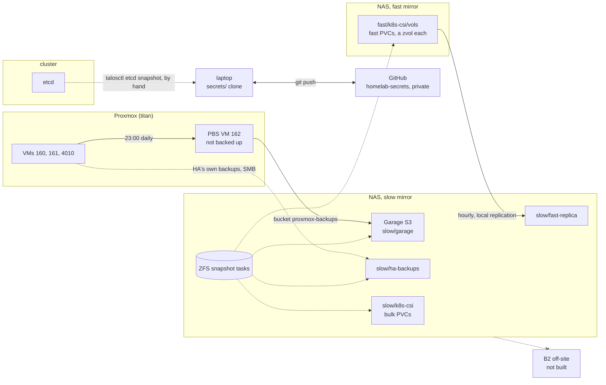

# Backups & restore

Every backup in the lab lands on one box: the NAS's `slow` mirror. Off-site
is not built, so the NAS is the single place everything is lost at once.



## Coverage {#coverage-matrix}

- **`fast` + replica** ([ZFS](#zfs-snapshots)): Vaultwarden, Memos db,
  Nextcloud db + html, Immich db, Mealie, DHS dump, Pocket ID, OpenBao, VMSingle,
  Alertmanager, VictoriaLogs
- **`bulk`** ([ZFS](#zfs-snapshots)): Memos attachments, Nextcloud files,
  Immich photos,
  Kassenbuch, Supplement tracker, Zot
- **[PBS](#pbs)**: VMs 160 (VPN), 161 (Home Assistant, plus
  [its own backups](#ha-backups)), 4010 (Talos)
- **[Secrets repo](#secrets-repo)**: `vault.yml`, tofu state (CAs, OpenBao
  values + seal key, Pocket ID key)
- **[etcd](#etcd-snapshots)**: by hand only
- **Nothing**: PBS VM 162, TrueNAS config, Proxmox `/etc/pve`, `.vault-pass`,
  `slow/users/*`, [off-site](#off-site). Glance is stateless.

## Scenario index

| This broke | Go to |
|--|--|
| A file deleted or overwritten on a NAS share | [ZFS snapshots](#zfs-snapshots) |
| A PVC's data wrong, PVC still there | [ZFS snapshots](#zfs-snapshots), *Restore a `fast` PVC* / *a `bulk` PVC* |
| A PVC deleted | [ZFS snapshots](#zfs-snapshots): `fast` from `slow/fast-replica` (the zvol's own snapshots go with it), `bulk` from `slow/k8s-csi` (the driver deletes the directory, the snapshots still hold it) |
| A dead or broken VM | [PBS](#pbs). Home Assistant also: [its own backups](#ha-backups) |
| Dead Proxmox node (titan, the only one) | [PBS](#pbs), *Dead node*: PBS first, then the VMs from it, then tofu |
| One dead `fast` NVMe on the NAS | [TrueNAS, *Replacing a drive*](platform/truenas.md#replace-drive) |
| Both `fast` NVMes dead | [ZFS snapshots](#zfs-snapshots), *Lost `fast` pool* |
| Lost cluster | [Recover from zero](recover-from-zero.md); the Talos VM from [PBS](#pbs), or rebuild and restore each `fast` PVC from its old zvol ([ZFS snapshots](#zfs-snapshots)); [etcd](#etcd-snapshots) only if a snapshot exists |
| Dead NAS | No recovery; [off-site](#off-site) not built |
| Lost laptop, or lost vault password | [Secrets repo](#secrets-repo) |

## ZFS snapshots {#zfs-snapshots}

**How it works.** Periodic snapshot tasks on the NAS (*Data Protection* ->
*Periodic Snapshot Tasks*). Copy-on-write, same pool: undo for mistakes, no
protection against losing the pool. Built in
[machines/truenas.md](build/machines/truenas.md#creating-datasets).

**Schedule / retention.**

| Dataset | Task | Keeps |
|--|--|--|
| `slow/k8s-csi` | hourly + daily, not recursive (PVs are directories) | 24h + 30d |
| `fast/k8s-csi/vols` | hourly + daily, recursive (a zvol per PV), same minute as `slow/k8s-csi` | 24h + 30d |
| `slow/fast-replica` | local replication of `fast/k8s-csi/vols` after each snapshot | same as source |
| `slow/garage` | daily, recursive (`meta` and `data` stay consistent) | 7d |
| `slow/ha-backups` | daily | 14d |
| `slow/users`, `slow/node-exporter` | none | -- |

Why the gaps:

- `fast` -- only `fast/k8s-csi/vols`, the zvols. democratic-csi refuses to
  delete a zvol whose snapshots carry `democratic-csi:managed_resource=true`,
  which snapshots inherit; a NAS cron flips it to `false` hourly at `:05`
  (until then a PVC delete just waits -- `PersistentVolumeStuckReleased`).
  The same cron copies `lab:pvc` onto the replica, which TrueNAS cannot send
  alongside re-encryption.
- `users` -- `files` is only a drop share, personal files live in
  [Nextcloud](workloads/nextcloud.md). `time-machine` below it: a snapshot
  pins the bands TM deletes; it grows forever.
- `garage` short -- snapshots pin the blocks PBS GC frees. Kept at all because
  Garage has no object lock: this is what survives a client deleting its own
  bucket.

**`fast` and its replica.** A `fast` PVC is a zvol named after its PV
(`pvc-<uuid>`), tagged `lab:pvc=<namespace>/<pvc>` at creation (see
[Storage](storage.md#fast)). The driver's delete takes the zvol's own
snapshots with it, so `slow/fast-replica` is what survives a deleted PVC and
a lost `fast` pool. It is a non-raw send, re-encrypted under `slow`'s key:
readable with only `slow` unlocked. Replication never restarts from scratch,
so a rebuilt `fast` cannot wipe it. A replica outlives its PVC:
retention only prunes datasets still on `fast`, so a deleted PVC's replica
keeps its last snapshots indefinitely, restorable like any other. Remove it by hand once the app is gone for good (*Removing an app*).

The copies are crash-consistent: SQLite and postgres recover from their
journal/WAL like after a power cut. Anything that does not fsync can lose
what was still in the page cache; the DHS dump is written aside, synced and
renamed for that reason.

**Health check.** `NasSnapshotStale` covers `fast/k8s-csi/vols`,
`slow/fast-replica` and `slow/k8s-csi`, `PersistentVolumeStuckReleased` a
dead fixup cron (see [Monitoring](monitoring.md#alerts)); the rest only
through TrueNAS's own alerts to Telegram (set up in the UI, not in this
repo). In the UI, the task list shows the last run. Or in a NAS shell (UI
*System* -> *Shell*):

```sh
zfs list -t snapshot -o name,creation -s creation slow/k8s-csi | tail -3
zfs list -t snapshot -o name,creation -s creation slow/fast-replica | tail -3
```

**Find a PVC's zvol.** On the NAS, by app -- a deleted PVC's old zvol is
only on the replica, under its old uuid:

```sh
zfs list -H -o name,lab:pvc -r fast/k8s-csi/vols slow/fast-replica | grep '<ns>/<pvc>$'
zfs list -t snapshot -o name,creation -s creation <zvol>
```

The live PVC's zvol is `fast/k8s-csi/vols/` plus
`kubectl -n <ns> get pvc <pvc> -o jsonpath='{.spec.volumeName}'`.

**Restore a `fast` PVC.** Clone the snapshot, `dd` it into the live zvol,
destroy the clone. Never `zfs rollback`: it destroys every newer snapshot and
breaks replication. The workload page gives the values for its app:

```sh
NS=vaultwarden KS=vaultwarden DEPLOY=vaultwarden PVC=vaultwarden-data
```

1. Stop the app so Flux does not scale it back up, which detaches the zvol.
   Pocket ID's Kustomization is `infrastructure`, which suspends every
   controller with it.
   ```sh
   flux suspend kustomization "$KS"
   kubectl -n "$NS" scale deploy/"$DEPLOY" --replicas=0
   ```
   If the PVC is gone: resume instead, let Flux recreate it and the pod bind
   it (`fast` provisions on first use), then suspend and scale to 0.
2. On the NAS, with `<src>` the chosen snapshot (on `fast`, or on
   `slow/fast-replica` for a deleted PVC or a lost pool), the clone in the
   same pool as `<src>`, and `<target>` the live PVC's zvol. The target must be
   at least the snapshot's size:
   ```sh
   zfs clone <src>@<snap> <pool>/restore-tmp
   ls -l /dev/zvol/<pool>/restore-tmp          # appears after a second or two
   dd if=/dev/zvol/<pool>/restore-tmp of=/dev/zvol/<target> bs=1M conv=fsync
   zfs destroy <pool>/restore-tmp
   ```
   A forgotten clone pins its origin and blocks that zvol's delete with
   "dependent clones".
3. Start the app:
   ```sh
   flux resume kustomization "$KS"
   ```

**Restore a `bulk` PVC.** Snapshots are browsable read-only under
`.zfs/snapshot/` in the dataset's mountpoint. A `bulk` PVC is a directory
under `slow/k8s-csi` (`pvc-<uuid>`, or a static one like `nextcloud/`); a
recreated PVC gets a new directory. Scale the app to 0, then on the NAS:

```sh
ls /mnt/slow/k8s-csi/.zfs/snapshot/
# one file or path
cp -a /mnt/slow/k8s-csi/.zfs/snapshot/<snap>/<dir>/<path> /mnt/slow/k8s-csi/<dir>/<path>
# the whole PVC -- both trailing slashes; --delete drops what the snapshot lacks
rsync -a --delete /mnt/slow/k8s-csi/.zfs/snapshot/<snap>/<old-dir>/ /mnt/slow/k8s-csi/<dir>/
```

Rolling a whole dataset back (`zfs rollback -r`) destroys every newer
snapshot. On `slow/garage` it also rolls back every bucket: for one bucket,
`zfs clone` the snapshot and copy out instead.

**Lost `fast` pool.** Replace the NVMes and recreate the pool per
[machines/truenas.md](build/machines/truenas.md#creating-pools), and the
snapshot task, but not the replication task yet -- see
[machines/truenas.md](build/machines/truenas.md#fast-snapshots). Every `fast`
PV now points at nothing: delete the PVCs, let Flux recreate them empty,
then restore each from `slow/fast-replica` as above, matching by `lab:pvc`.
OpenBao can instead be re-initialised per
[platform/README.md](build/platform/README.md#first-install) and refilled by
`mise run platform apply`. Then move the old replica aside
(`zfs rename slow/fast-replica slow/fast-replica-old`) -- the new `fast`
shares no snapshot with it -- recreate the replication task, and destroy
`-old` once the new replica has run.

**Removing an app.** Its zvols on `fast` go with its PVCs; their replicas
stay, on purpose -- they are the undo for a deleted PVC. Once the app is gone
for good:

```sh
zfs list -H -o name,lab:pvc -r slow/fast-replica | grep '<ns>/'
zfs destroy -r slow/fast-replica/pvc-<uuid>
```

## PBS on Garage {#pbs}

**How it works.** A PVE job backs up every VM except PBS (162) to the PBS
VM, whose datastore `proxmox-backups` is S3 in Garage (bucket
`proxmox-backups`, quota 300G) with a local cache disk. Incremental,
deduplicated, per-VM and per-file restore. Built in
[guests/README.md](build/guests/README.md#backups); component:
[Proxmox Backup Server](platform/pbs.md). PBS skips itself (it cannot restore
itself, and would back up its own chunk store), so its config is not backed up.

**Not client-side encrypted**: `pbs-s3` has no encryption key. Anyone with
the Garage key reads every VM disk.

**Schedule / retention.** In this order: prune must see the backup, GC is the
expensive one. PVE's job keeps all; pruning is PBS's alone.

| Job | Where | Schedule |
|--|--|--|
| Backup | PVE *Datacenter* -> *Backup*, snapshot mode, exclude 162 | `23:00` daily |
| Prune | PBS datastore | `04:00` daily: last 3, d7 w4 m6 |
| GC | PBS datastore | `sun 05:00` |
| Verify | PBS datastore | `sat 22:00`, skip verified |

**Credentials.**

| What | Where |
|--|--|
| PBS -> Garage | `garage_pbs_key_id` / `garage_pbs_secret_key` in `secrets/vault.yml` |
| PVE -> PBS | token `backup@pbs!lab` (DatastoreBackup), stored in `/etc/pve/priv/storage/pbs-s3.pw` |
| PBS UI | Pocket ID; `root@pam` break-glass |

**Health check.** Nothing in VictoriaMetrics; PVE notifies failures to Telegram
(set up in the UI). PBS -> *Datastore* -> `proxmox-backups` -> *Content*
shows last snapshot and verify state per VM. On titan:

```sh
pvesm list pbs-s3 | tail
```

**Restore a VM.** UI: VM -> *Backup* -> pick -> *Restore*. Or on titan:

```sh
pvesm list pbs-s3 --vmid <id>
qm stop <id>                                                  # if it still exists
qmrestore pbs-s3:backup/vm/<id>/<timestamp> <id> --storage local --force 1
```

Single files: *Storage* `pbs-s3` -> *Backups* -> *File Restore*.

**Dead node.** PBS dies with titan; the backups are in Garage.

1. Reinstall the node ([machines/proxmox.md](build/machines/proxmox.md)),
   then `mise run machine-config`.
2. Only the PBS VM: `mise run guests apply -target=proxmox_virtual_environment_vm.pbs`.
   **Not** a full `guests apply` -- that would create the other VMs empty
   under the IDs the restores need.
3. Install PBS and re-add the S3 endpoint and datastore on the existing
   bucket, token, storage entry and jobs per
   [guests/README.md](build/guests/README.md#backups).
4. Restore the VMs as above.
5. `mise run guests plan` -- should now be close to a no-op.

**Restoring the Talos VM** rolls etcd back to 23:00. PVCs live on the NAS:
ones created since are orphans on `fast`, ones deleted since are PVs pointing
at nothing.

## Home Assistant's own backups {#ha-backups}

**How it works.** Home Assistant writes its own backups to the NAS share
`ha-backups` (dataset `slow/ha-backups`, with a quota) over SMB, as the
`ha-backup` service account. Application-level: restores a configuration into
a running Home Assistant, and survives PBS. Scheduled and encrypted inside the
appliance, not in this repo.

**Schedule / retention.** In Home Assistant: *Settings* -> *System* ->
*Backups*. Not recorded here. On top, the ZFS task on `slow/ha-backups` keeps
14 daily snapshots.

**Credentials.** The `ha-backup` SMB password, and Home Assistant's backup
encryption key. Without the key the backups are unreadable.

**Health check.** Nothing alerts. *Settings* -> *System* -> *Backups* shows the
last successful one; the share shows the files.

**Restore.** Into a running instance: *Settings* -> *System* -> *Backups* ->
pick -> *Restore*. Into a fresh one (e.g. a VM rebuilt from the image): copy
the `.tar` off the share, choose *Upload backup* at onboarding, give the key.
App specifics: [Home Assistant](workloads/home-assistant.md).

## Secrets repo {#secrets-repo}

**How it works.** `secrets/` is a submodule backed by the private GitHub repo
`Sojamann/homelab-secrets`. It holds everything the lab is built from that
cannot be public, encrypted:

| File | Committed | Unlocked by |
|--|--|--|
| `vault.yml` | yes, ansible-vault | `.vault-pass` |
| `proxmox-token.yml` | yes, ansible-vault | `.vault-pass` |
| `state/<layer>.tfstate` | yes, OpenTofu state encryption | `terraform_state_passphrase`, inside `vault.yml` |
| `.vault-pass` | **no** | -- |
| `guests-ssh-key`, `talosconfig`, `kubeconfig` | no | regenerated by their tofu layer |

The tofu state is the backup for everything tofu generated: Talos and
Kubernetes CAs, the OpenBao seal key, Pocket ID's encryption key and every
OpenBao value. Git history keeps every earlier version. Details:
[Access & secrets](access.md).

**Schedule / retention.** Every `mise run save`, kept forever. A commit is a
backup only once pushed: `mise run save` commits, `git push` carries the
submodule along.

**Credentials.** The `.vault-pass` file, and a GitHub login with access to
the private repo. **Losing the vault password makes the vault and every
state unreadable**, history included -- the passphrase is inside the vault.

**Health check.**

```sh
git -C secrets status -sb      # "ahead" means not on GitHub yet
git status -sb
```

**Restore** (lost laptop):

```sh
git clone --recurse-submodules git@github.com:Sojamann/homelab.git
cd homelab
# put the vault password at secrets/.vault-pass, mode 0600
mise run cluster plan    # proves vault + state decrypt
# talosconfig/kubeconfig come back with the next `mise run cluster apply`
```

## etcd snapshots {#etcd-snapshots}

**How it works.** By hand, before a Talos or Kubernetes upgrade (see
[Maintenance](maintenance.md)). The file lands wherever you ran the command.
Not scheduled, not kept anywhere in particular. The cluster is mostly
rebuildable without it: tofu state + the apps repo + the NAS snapshots.

```sh
talosctl -n talos-cp-1.<lab_domain> etcd snapshot ./etcd-$(date +%F).snapshot
```

**Credentials.** `secrets/talosconfig`. The snapshot itself contains every
Kubernetes Secret in clear: keep it out of the repo.

**Restore.** Onto a control plane whose etcd is not yet bootstrapped:

```sh
talosctl -n talos-cp-1.<lab_domain> bootstrap --recover-from=./etcd-<date>.snapshot
```

The cluster layer bootstraps etcd itself on apply, so this has to happen
before that resource runs. Untested here; upstream:
[Talos disaster recovery](https://www.talos.dev/latest/advanced/disaster-recovery/).

## Off-site (B2) {#off-site}

**Not built.** Intended: Backblaze B2, Nextcloud's files and
Immich's photos first.
Until it exists, losing the NAS loses every backup on this page.
