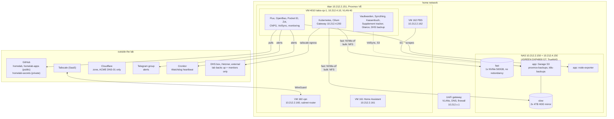

# Overview

**Lab down, or rebuilding?** Start at [Recover from zero](recover-from-zero.md).
Something specific broke: the [scenario index](backups.md#scenario-index).

One Proxmox host, one NAS, one single-node Talos cluster on a VM. Everything
the household uses is behind one gateway address, reachable on the LAN and the
tailnet, never from the internet.

The hostnames `enceladus`, `mimas`, `rhea`, `iapetus` and `dione`
(`10.212.2.152-.156`) are reserved in DNS and the inventory, but titan is the
only Proxmox node in service.

## Where to look

| Question | Page |
|--|--|
| How do I rebuild everything, in what order? | [Recover from zero](recover-from-zero.md) |
| What does the household use, and how is each one run? | [Workloads](workloads/index.md) |
| How does an infrastructure piece work, how do I log in when SSO is down? | [Platform](platform/index.md), [Access & secrets](access.md) |
| Which VLAN, which address, why can't X reach Y? | [Networking](networking.md) |
| Where does a PVC or a dataset physically live? | [Storage](storage.md) |
| What is backed up, how do I get it back? | [Backups & restore](backups.md) |
| Why did my phone buzz? | [Monitoring & alerting](monitoring.md) |
| What do I check, and how do I upgrade? | [Maintenance](maintenance.md) |
| What is `<app_domain>`? | [Conventions](conventions.md) |

## Topics and the Build guide

*Topics* (this part) say how things work, how they are run and how they come
back. The *Build guide* is the stage docs, one per layer of the repo, and says
only how to build or rebuild that layer. The layers, in order, each depending
on the ones before:

| Layer | Tool | Owns |
|--|--|--|
| [bootstrap](build/bootstrap/README.md) | by hand | UniFi controller, Cloudflare zone, tailnet, workstation |
| [network](build/network/README.md) | OpenTofu | VLANs, DHCP, DNS, firewall, wifi, tailnet policy |
| [machines](build/machines/README.md) | by hand | OS installs, ZFS pools, SSH keys, Proxmox cluster |
| [machine-config](build/machine-config/README.md) | Ansible | host state |
| [guests](build/guests/README.md) | OpenTofu | VMs |
| [cluster](build/cluster/README.md) | OpenTofu | Talos, Kubernetes, Cilium |
| [platform](build/platform/README.md) | OpenTofu | storage, Flux, front door, OpenBao |
| [flux](build/flux/README.md) | Flux | the workloads (repo `homelab-apps`, the `flux/` submodule) |
