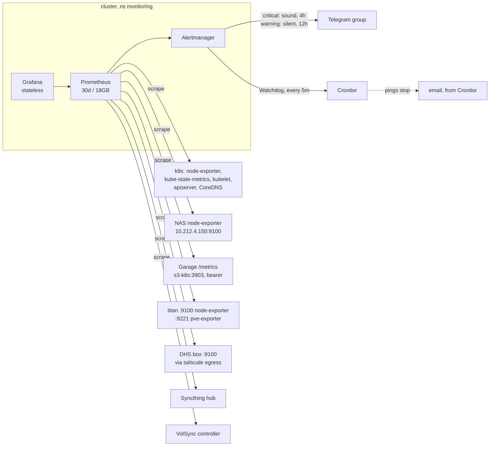

# Monitoring & alerting

## What it's for

One Prometheus in the cluster watches the cluster, the NAS, the Proxmox host
and the DHS box; Alertmanager posts to one Telegram group; Grafana shows it.
A heartbeat outside the lab notices when all of that is down at once. The
stack is kube-prometheus-stack (chart in
`flux/infrastructure/controllers/kube-prometheus-stack/`); rules, scrapes and
dashboards are under `flux/infrastructure/configs/` or beside the app that
owns them.



## Access {#access}

| What | URL | Login |
|--|--|--|
| Grafana | `https://grafana.<app_domain>` | anonymous = Viewer; *Sign in with Pocket ID*: `admins` -> Admin, else Viewer. Break-glass: the admin form, credentials in `kv/monitoring/grafana` (see [break-glass](access.md#break-glass)) |
| Alertmanager | `https://alertmanager.<app_domain>` | **none**: every LAN and tailnet device can silence an alert -- the price of silencing from a phone |
| Prometheus | no route | `kubectl -n monitoring port-forward svc/kube-prometheus-stack-prometheus 9090` |

Grafana sessions die with the pod (its sqlite is on an emptyDir).

## Where it runs

Namespace `monitoring` (labelled privileged, for node-exporter), Flux
Kustomization `infrastructure`; rules and scrapes in
`infrastructure-configs`. Wiring:
[Build guide: Monitoring](build/flux/docs/monitoring.md).

## What is watched

| Target | How | Job |
|--|--|--|
| k8s nodes, pods, PVCs | chart: node-exporter DaemonSet, kube-state-metrics, kubelet/cAdvisor, apiserver, CoreDNS | chart defaults |
| NAS host + pools | node-exporter custom app on TrueNAS, plus a cron textfile for pool size | `nas` |
| Garage | its admin `/metrics`, bearer `garage_metrics_token` | `garage` |
| titan | node-exporter + pve-exporter (installed by machine-config), through `metrics-allow-proxmox` | `proxmox`, `pve` |
| DHS box | node-exporter over the tailnet | `dhs` |
| Syncthing hub | its metrics endpoint | `syncthing` |
| VolSync | controller metrics | -- |

etcd, scheduler, controller-manager and kube-proxy are off: Talos binds them to
`127.0.0.1` (and Cilium replaces kube-proxy), so they would be permanently
down.

**Not watched** -- seen only by looking:

- PBS backup, prune, GC and verify jobs -- PVE and PBS notify on failure,
  to Telegram (set up in the UI, not in this repo)
- ZFS snapshot and scrub tasks -- TrueNAS's own alerts, to Telegram (set up in the UI, not in this repo); SMART (not
  exported, and not set up)
- Home Assistant and its own backups. The firewall allows a scrape on
  `10.212.2.161:8123`, but no scrape config exists.
- Proxmox and TrueNAS certificate renewals
- TrueNAS's own alerts go wherever its alert delivery is configured -- not
  recorded here.

## Alerts {#alerts}

Lab rules, all labelled `origin: lab`:

| Alert | Severity | Fires when | Defined in |
|--|--|--|--|
| `NasDown` | critical | NAS node-exporter unreachable 5m | `infrastructure/configs/nas/` |
| `NasPoolNotOnline` | critical | a pool not `ONLINE` 5m | same |
| `NasPoolFull` | warning | a pool > 80% for 15m | same |
| `GarageDown` | critical | Garage metrics unreachable 5m | `infrastructure/configs/garage/` |
| `ProxmoxExporterDown` | critical | node- or pve-exporter unreachable 5m | `infrastructure/configs/proxmox/` |
| `ProxmoxQuorumLost` | critical | cluster not quorate 5m | same |
| `ProxmoxStorageFull` | warning | a PVE storage > 80% for 15m | same |
| `ProxmoxGuestDown` | warning | an onboot guest not running 10m | same |
| `VolSyncBackupFailing` | warning | a ReplicationSource out of sync 1h | `infrastructure/configs/volsync/` |
| `VolSyncMetricsAbsent` | warning | no sync status at all 1h (controller or scrape dead) | same |
| `DhsDown` | critical | DHS box unreachable over the tailnet 5m | `apps/dhs/rules.yaml` |
| `DhsDumpStale` | warning | no successful dump in 26h | same |
| `SyncthingDown` | critical | hub not scraped 10m | `apps/syncthing/monitoring.yaml` |
| `SyncthingFolderError` | warning | a folder in error 1h | same |
| `SyncthingFolderOutOfSync` | warning | the hub behind on a folder 6h | same |
| `SyncthingDeviceUnseen` | warning | a device not connected for 7 days | same |

Plus the ~134 rules the chart ships (pods crash-looping, PVC filling up,
node pressure, `Watchdog`, ...). Find ours among them with `origin="lab"` in
Alertmanager or `label:origin=lab` in Grafana. What each app alert means for
that app is on its workload page.

## Where alerts go {#routing}

Everything lands in one Telegram group. PVE, PBS and TrueNAS send their own
notifications there too, set up in their UIs, not in this repo.

| Route | Matches | Delivery | Repeats |
|--|--|--|--|
| `heartbeat` | `alertname="Watchdog"` | webhook to the heartbeat URL | every 5m |
| `telegram-critical` | `severity="critical"` | Telegram, with sound | every 4h |
| `telegram` | everything else | Telegram, silent | every 12h |

Grouped by `alertname, cluster, namespace`. The chart's default inhibition
mutes a warning that a critical of the same alertname and namespace explains.
Each message links to Alertmanager (to silence) and Grafana.

A notification per warning is how you learn to swipe warnings away, so
warnings are silent. **Too noisy is fixed in the rule, not in the routing.**

Grafana's own alerting is unused: one alerting engine, Prometheus. Grafana is
stateless, so a rule made in its UI is gone on the next restart.

### Watchdog heartbeat {#watchdog}

`Watchdog` fires permanently by design. It is routed to a heartbeat URL
(Cronitor) instead of the chat: when the pings stop -- because Prometheus, the
cluster, the NAS or the WAN broke -- Cronitor notices, from outside the lab,
which nothing inside it can, and sends an email. The URL is all the repo
knows; the account and the email are configured in Cronitor.

### Credentials

| Value | Vault key | Reaches Alertmanager via |
|--|--|--|
| Telegram bot token | `telegram_bot_token` | `kv/monitoring/alerting`, mounted as a file |
| Telegram group id | `telegram_chat_id` | `cluster-vars` (not a credential, but names a private group) |
| Heartbeat URL | `heartbeat_url` | `kv/monitoring/alerting`, mounted as a file |

Rotate: change the vault, `mise run platform apply`, force-sync the
`alerting` ExternalSecret (see [Rotating](access.md#rotating)); Alertmanager
re-reads the files.

## Dashboards

The chart's own are off. Ours live flat in
`flux/infrastructure/configs/dashboards/`, no folders:

| Dashboard | For |
|--|--|
| Lab (home) | traffic lights only -- NAS pools + host, Proxmox hosts + storage, k8s nodes, the DHS box: status, CPU, memory, disk, network errors/drops; each links to its detail dashboard |
| K8s Overview | the quick look -- CPU, memory (usage + requests), network, disk per node; what each PVC holds |
| K8s Detail | digging in -- stats, per namespace, per pod CPU/throttling/memory, a pods table |
| NAS | pool fill + state, CPU, memory with ARC split out, ARC hit ratio, network |
| Garage | upstream's: API requests + errors, disk I/O, resync and table queues |
| Proxmox | quorum, storage fill, CPU, memory (usage + assigned), root fs, network per host; a guests table |

Anything else: Prometheus via *Explore*.

## TrueNAS node-exporter {#truenas}

A custom app on the NAS (`machines/truenas/apps/node-exporter/compose.yaml`),
`network_mode: host`, listening on `10.212.4.150:9100` only -- same VLAN as the
cluster, no firewall rule. node-exporter cannot see pool size, so a root cron
job writes it every minute to the textfile directory `slow/node-exporter`
(`nas_zpool_size_bytes`, `nas_zpool_allocated_bytes`, `nas_zpool_free_bytes`;
written to `.tmp` and `mv`'d so it is never read half-written). Pool state
(`node_zfs_zpool_state`) comes from node-exporter itself. Install steps:
[Build guide: TrueNAS](build/machines/truenas.md#monitoring).

```sh
curl -s http://10.212.4.150:9100/metrics | grep -E '^(nas_zpool|node_zfs_zpool_state)'
```

Every pool with a size, and `state="online"` at `1`. A bump of its image is
not applied automatically: edit the app in TrueNAS and set the tag (see
[Maintenance](maintenance.md#nas)).

## Data

| What | Where | State? |
|--|--|--|
| Prometheus TSDB | `fast` PVC 20Gi; dropped after 30d or 18GB, size cap first | history only |
| Alertmanager silences, notification log | `fast` PVC 1Gi | barely |
| Grafana | emptyDir | no -- dashboards from ConfigMaps, users from Pocket ID |

## Backup & restore

Nothing is backed up -- see the [coverage matrix](backups.md#coverage-matrix).
Everything that defines the stack is in git and the secrets in OpenBao; a
lost PVC is lost history and silences. Delete the PVC, let Flux recreate it.

**Verify** after a rebuild: Prometheus *Status* -> *Targets* all up;
Alertmanager shows only `Watchdog` firing; Cronitor shows pings arriving; the
Lab dashboard is all green. Test the Telegram path with a throwaway alert:

```sh
kubectl -n monitoring exec alertmanager-kube-prometheus-stack-alertmanager-0 -- \
  amtool alert add TestAlert severity=warning --alertmanager.url=http://localhost:9093
```

## Admin

- **A new rule**: a `PrometheusRule` beside the app (or in
  `infrastructure/configs/<x>/` for things outside the cluster), labels
  `severity` and `origin: lab`, an annotation `summary`. Prometheus picks up
  rules, monitors and scrape configs in every namespace.
- **A new target outside the cluster**: a `ScrapeConfig` with
  `staticConfigs`; if it is outside k8s, it also needs a firewall allow (see
  [Networking](networking.md#firewall)).
- **Changing a dashboard**: edit in the UI, *Share* -> *Export* -> paste over
  the JSON file, commit. An unexported edit is gone on the next restart. A new
  dashboard is a new file plus a `configMapGenerator` entry in
  `infrastructure/configs/dashboards/kustomization.yaml`.
- **Silencing** from a phone: the *silence* link in the Telegram message.

## What breaks without it

Prometheus or Alertmanager down: no alerts at all, but Cronitor notices
within minutes. Grafana down: no dashboards, alerts unaffected. Nothing else
depends on the stack.

## Gotchas

- **Watchdog missing ≠ Telegram broken.** Cronitor alerts on missing pings;
  a broken bot token only shows as no messages. Send a test alert after any
  change to the alerting secret.
- **Telegram rejects a message whose markup does not parse**, and the alert is
  then lost to a log line. The template uses HTML for that reason.
- **No CPU limits** anywhere in the stack: they cause the throttling it
  watches for. Memory limits are leak ceilings.
- **Grafana at 400Mi** was ~200KiB under its peak and got killed on liveness;
  it has 1Gi now.
