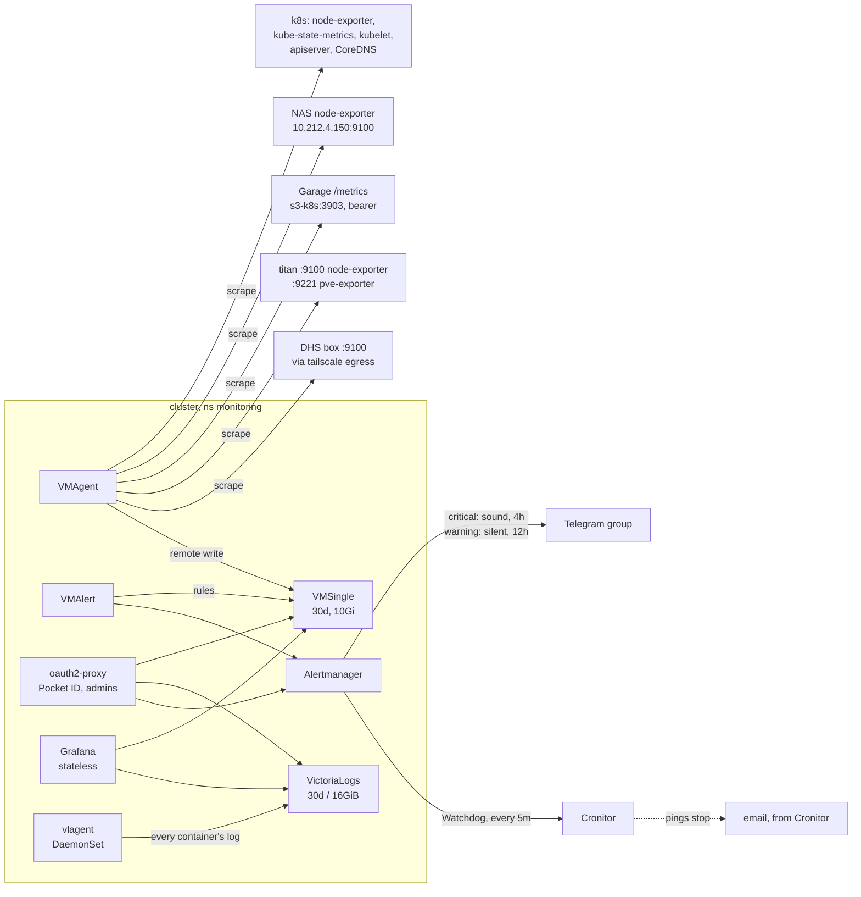

# Monitoring & alerting

## What it's for

One VictoriaMetrics in the cluster watches the cluster, the NAS, the Proxmox
host and the DHS box; Alertmanager posts to one Telegram group; Grafana shows
it. A heartbeat outside the lab notices when all of that is down at once. The
stack is victoria-metrics-k8s-stack (chart in
`flux/infrastructure/controllers/victoria-metrics/`): VMAgent scrapes into
VMSingle, VMAlert evaluates rules against it and sends to Alertmanager. Rules,
scrapes and dashboards are under `flux/infrastructure/configs/` or beside the
app that owns them, as native VictoriaMetrics kinds (`VMRule`,
`VMScrapeConfig`, ...) -- no Prometheus-operator CRDs are installed. Container
logs go to VictoriaLogs, read in the same Grafana (see [Logs](#logs)).



## Access {#access}

| What | URL | Login |
|--|--|--|
| Grafana | `https://grafana.<app_domain>` | *Sign in with Pocket ID*: `admins` -> Admin, anyone else refused; no anonymous access. Break-glass: the admin form, credentials in `kv/monitoring/grafana` (see [break-glass](access.md#break-glass)) |
| VMUI (metrics) | `https://metrics.<app_domain>/vmui` | oauth2-proxy: Pocket ID, `admins` only. Break-glass: `kubectl -n monitoring port-forward svc/vmsingle-vm 8428` |
| VictoriaLogs | `https://logs.<app_domain>/select/vmui` | same. Break-glass: `kubectl -n monitoring port-forward svc/victoria-logs-server 9428` |
| Alertmanager | `https://alertmanager.<app_domain>` | same. Break-glass: `kubectl -n monitoring port-forward svc/vmalertmanager-vm 9093` |
| VMAlert | no route | `kubectl -n monitoring port-forward svc/vmalert-vm 8080`; rule state is in VMUI and Grafana too |

Grafana is login-only because of the logs: in OSS Grafana every Viewer can
query every datasource, and logs carry emails, IPs and whatever an app prints
at startup. VMUI, VictoriaLogs and Alertmanager have no auth of their own, so
oauth2-proxy sits in front. Cilium's Gateway has no external-auth hook, so it
is a reverse proxy in the data path, one container per hostname in one pod.
One Pocket ID client and one cookie on `.<app_domain>`: a login on one is a
login on all three. The Telegram *silence* link costs a passkey tap.

Grafana sessions die with the pod (its sqlite is on an emptyDir).

## Where it runs

Namespace `monitoring` (labelled privileged, for node-exporter), Flux
Kustomization `infrastructure`; rules and scrapes in
`infrastructure-configs`. Wiring:
[Build guide: Monitoring](build/flux/docs/monitoring.md).

## What is watched

| Target | How | Job |
|--|--|--|
| k8s nodes, pods, PVCs | chart: node-exporter DaemonSet, kube-state-metrics, kubelet/cAdvisor, apiserver, CoreDNS; VM's own components | chart defaults |
| NAS host + pools | node-exporter custom app on TrueNAS, plus a cron textfile for pool size | `nas` |
| Garage | its admin `/metrics`, bearer `garage_metrics_token` | `garage` |
| titan | node-exporter + pve-exporter (installed by machine-config), through `metrics-allow-proxmox` | `proxmox`, `pve` |
| DHS box | node-exporter over the tailnet | `dhs` |

etcd, scheduler, controller-manager and kube-proxy are off: Talos binds them to
`127.0.0.1` (and Cilium replaces kube-proxy), so they would be permanently
down.

**Not watched** -- seen only by looking:

- PBS backup, prune, GC and verify jobs -- PVE and PBS notify on failure,
  to Telegram (set up in the UI, not in this repo)
- ZFS scrub tasks, and snapshot tasks other than the ones `NasSnapshotStale`
  watches -- TrueNAS's own alerts, to Telegram (set up in the UI, not in this
  repo); SMART (not exported, and not set up)
- Home Assistant and its own backups. No scrape, and k8s cannot reach the
  VM (`k8s-deny-internal`).
- Proxmox and TrueNAS certificate renewals
- TrueNAS's own alerts go wherever its alert delivery is configured -- not
  recorded here.

## Alerts {#alerts}

Lab rules, all labelled `origin: lab`:

| Alert | Severity | Fires when | Defined in |
|--|--|--|--|
| `NasDown` | critical | NAS node-exporter unreachable 5m | `infrastructure/configs/nas/` |
| `NasPoolNotOnline` | critical | a pool not `ONLINE` 5m | same |
| `NasPoolFull` | warning | a pool > 80% for 15m | same |
| `NasSnapshotStale` | warning | newest snapshot of `fast/k8s-csi/vols`, `slow/fast-replica` or `slow/k8s-csi` older than 2h, for 15m | same |
| `NasSnapshotMetricsAbsent` | warning | no snapshot metrics at all 1h (textfile cron gone) | same |
| `PersistentVolumeStuckReleased` | warning | a `fast` PV `Released` 1h -- the delete is blocked, see [Storage](storage.md#fast) | same |
| `GarageDown` | critical | Garage metrics unreachable 5m | `infrastructure/configs/garage/` |
| `ProxmoxExporterDown` | critical | node- or pve-exporter unreachable 5m | `infrastructure/configs/proxmox/` |
| `ProxmoxQuorumLost` | critical | cluster not quorate 5m | same |
| `ProxmoxStorageFull` | warning | a PVE storage > 80% for 15m | same |
| `ProxmoxGuestDown` | warning | an onboot guest not running 10m | same |
| `DhsDown` | critical | DHS box unreachable over the tailnet 5m | `apps/dhs/rules.yaml` |
| `DhsDumpStale` | warning | no successful dump in 26h | same |
| `VictoriaLogsDown` | warning | VictoriaLogs not scraped 10m | `infrastructure/configs/victoria-logs/` |
| `VictoriaLogsRetentionShort` | warning | its PVC > 90% of the 16GiB cap for 1h: logs dropped before 30d | same |
| `VlagentDropping` | warning | a collector dropped log blocks in the last hour | same |

Plus the rules the chart ships (pods crash-looping, PVC filling up, node
pressure, VictoriaMetrics health, `Watchdog`, ...). Find ours among them with
`origin="lab"` in Alertmanager or `label:origin=lab` in Grafana. What each app
alert means for that app is on its workload page.

The chart's rules are not in the chart: its sync-job downloads them from
GitHub at deploy time and writes them as `VMRule`s, again whenever the values
change. Each source URL is pinned to a release tag in `release.yaml` (the
chart's default is `master`); Renovate bumps the tags.

## Where alerts go {#routing}

Everything lands in one Telegram group. PVE, PBS and TrueNAS send their own
notifications there too, set up in their UIs, not in this repo.

| Route | Matches | Delivery | Repeats |
|--|--|--|--|
| `heartbeat` | `alertname="Watchdog"` | webhook to the heartbeat URL | every 5m |
| `telegram-critical` | `severity="critical"` | Telegram, with sound | every 4h |
| `telegram` | everything else | Telegram, silent | every 12h |

Grouped by `alertname, cluster, namespace`. Inhibition is kube-prometheus'
default, spelled out in `release.yaml` because this chart ships none: a
critical mutes the warning of the same alertname and namespace.
Each message links to Alertmanager (to silence) and Grafana.

A notification per warning is how you learn to swipe warnings away, so
warnings are silent. **Too noisy is fixed in the rule, not in the routing.**

Grafana's own alerting is unused: one alerting engine, VMAlert. Grafana is
stateless, so a rule made in its UI is gone on the next restart.

### Watchdog heartbeat {#watchdog}

`Watchdog` fires permanently by design. It is routed to a heartbeat URL
(Cronitor) instead of the chat: when the pings stop -- because VictoriaMetrics, the
cluster, the NAS or the WAN broke -- Cronitor notices, from outside the lab,
which nothing inside it can, and sends an email. The URL is all the repo
knows; the account and the email are configured in Cronitor.

### Credentials

| Value | Vault key | Reaches Alertmanager via |
|--|--|--|
| Telegram bot token | `telegram_bot_token` | `kv/monitoring/alerting`, mounted as a file |
| Telegram group id | `telegram_chat_id` | `cluster-vars` (not a credential, but names a private group) |
| Heartbeat URL | `heartbeat_url` | `kv/monitoring/alerting`, mounted as a file |

Rotate: change the vault, `mise run platform apply`, force-sync the
`alerting` ExternalSecret; Alertmanager
re-reads the files.

## Dashboards

The chart's own are off. Ours live flat in
`flux/infrastructure/configs/dashboards/`, no folders:

| Dashboard | For |
|--|--|
| Lab (home) | traffic lights only -- NAS pools + host, Proxmox hosts + storage, k8s nodes, the DHS box: status, CPU, memory, disk, network errors/drops; each links to its detail dashboard |
| K8s Overview | the quick look -- CPU, memory (usage + requests), network, disk per node; what each PVC holds |
| K8s Detail | digging in -- stats, per namespace, per pod CPU/throttling/memory, a pods table |
| NAS | pool fill + state, CPU, memory with ARC split out, ARC hit ratio, network |
| Garage | upstream's: API requests + errors, disk I/O, resync and table queues |
| Proxmox | quorum, storage fill, CPU, memory (usage + assigned), root fs, network per host; a guests table |

Anything else: *Explore* -> VictoriaMetrics, or VMUI. Logs: *Explore* -> VictoriaLogs; no
logs dashboard yet.

## Logs {#logs}

Every container in every namespace, nothing else: no Talos node logs
(`talosctl logs` / `talosctl dmesg`), no other VMs, and not the DHS box
(a pull design is a todo in `todo.txt`).

| Piece | What | Defined in |
|--|--|--|
| vlagent | DaemonSet, tails `/var/log/containers`, ships to VictoriaLogs | `controllers/victoria-logs/collector.yaml` |
| VictoriaLogs | single binary, StatefulSet `victoria-logs-server`, `:9428` | `controllers/victoria-logs/server.yaml` |
| datasource | Grafana plugin `victoriametrics-logs-datasource`, uid `victoria-logs` | `controllers/victoria-metrics/release.yaml` |

- **Retention:** 30d or 16GiB, whichever first, on a 20Gi `fast` PVC. Near
  the cap the oldest logs go first and `VictoriaLogsRetentionShort` fires:
  grow the PVC (online, never shrinks) and `retentionDiskSpaceUsage` together.
- **Streams** are `namespace`, `pod`, `container`
  (`kubernetes.pod_namespace`, `kubernetes.pod_name`,
  `kubernetes.container_name`); pod labels ride along. JSON lines are split
  into fields.
- **VictoriaLogs down:** each node buffers up to 1GiB in
  `/var/lib/vl-collector` (with its read checkpoints) and sends it later.

Query, in *Explore*:

```
{kubernetes.pod_namespace="vaultwarden"} error
```

## TrueNAS node-exporter {#truenas}

A custom app on the NAS (`machines/truenas/apps/node-exporter/compose.yaml`),
`network_mode: host`, listening on `10.212.4.150:9100` only -- same VLAN as the
cluster, no firewall rule. node-exporter cannot see pool size, so a root cron
job writes it every minute to the textfile directory `slow/node-exporter`
(`nas_zpool_size_bytes`, `nas_zpool_allocated_bytes`, `nas_zpool_free_bytes`;
written to `.tmp` and `mv`'d so it is never read half-written). A second one,
every 10 minutes, writes `nas_snapshot_newest_timestamp_seconds{dataset}` for
the snapshot datasets that [Backups](backups.md#zfs-snapshots) relies on. Pool state
(`node_zfs_zpool_state`) comes from node-exporter itself. Install steps:
[Build guide: TrueNAS](build/machines/truenas.md#monitoring).

```sh
curl -s http://10.212.4.150:9100/metrics | grep -E '^(nas_zpool|nas_snapshot|node_zfs_zpool_state)'
```

Every pool with a size, and `state="online"` at `1`. A bump of its image is
not applied automatically: edit the app in TrueNAS and set the tag (see
[Maintenance](maintenance.md#nas)).

## Data

| What | Where | State? |
|--|--|--|
| VMSingle | `fast` PVC 10Gi; dropped after 30d, **no size cap** | history only |
| Alertmanager silences, notification log | `fast` PVC 1Gi | barely |
| VictoriaLogs | `fast` PVC 20Gi (`server-volume-victoria-logs-server-0`); dropped after 30d or 16GiB | history only |
| Grafana | emptyDir | no -- dashboards from ConfigMaps, users from Pocket ID |

## Backup & restore

Nothing is backed up -- see the [coverage matrix](backups.md#coverage-matrix).
Everything that defines the stack is in git and the secrets in OpenBao; a
lost PVC is lost history and silences. Delete the PVC, let Flux recreate it.

**Verify** after a rebuild: VMAgent's targets all up
(`kubectl -n monitoring port-forward svc/vmagent-vm 8429`, then `/targets`);
Alertmanager shows only `Watchdog` firing; Cronitor shows pings arriving; the
Lab dashboard is all green; *Explore* -> VictoriaLogs shows lines from the
last minute. Test the Telegram path with a throwaway alert:

```sh
kubectl -n monitoring exec vmalertmanager-vm-0 -- \
  amtool alert add TestAlert severity=warning --alertmanager.url=http://localhost:9093
```

## Admin

- **A new rule**: a `VMRule` beside the app (or in
  `infrastructure/configs/<x>/` for things outside the cluster), labels
  `severity` and `origin: lab`, an annotation `summary`. VMAgent and VMAlert
  pick up rules, scrapes and scrape configs in every namespace.
- **A new target in the cluster**: a `VMServiceScrape` or `VMPodScrape`
  beside it (most charts have a `vmServiceScrape` value).
- **A new target outside the cluster**: a `VMScrapeConfig` with
  `staticConfigs`, plus a `job` relabel -- it has no `jobName`, and the
  operator's default (`scrapeConfig/<ns>/<name>`) matches nothing. Outside
  k8s, it also needs a firewall allow (see
  [Networking](networking.md#firewall)).
- **Changing a dashboard**: edit in the UI, *Share* -> *Export* -> paste over
  the JSON file, commit. An unexported edit is gone on the next restart. A new
  dashboard is a new file plus a `configMapGenerator` entry in
  `infrastructure/configs/dashboards/kustomization.yaml`.
- **Silencing** from a phone: the *silence* link in the Telegram message.

## What breaks without it

VMSingle, VMAgent, VMAlert or Alertmanager down: no alerts at all, but Cronitor notices
within minutes. Grafana down: no dashboards, alerts unaffected. oauth2-proxy or Pocket ID
down: VMUI, VictoriaLogs and Alertmanager only by port-forward. VictoriaLogs
down: no logs in Grafana, collected later from the nodes' buffers. Nothing
else depends on the stack.

## Gotchas

- **Watchdog missing ≠ Telegram broken.** Cronitor alerts on missing pings;
  a broken bot token only shows as no messages. Send a test alert after any
  change to the alerting secret.
- **Telegram rejects a message whose markup does not parse**, and the alert is
  then lost to a log line. The template uses HTML for that reason.
- **No CPU limits** anywhere in the stack: they cause the throttling it
  watches for. Memory limits are leak ceilings.
- **Both datasource plugins are downloaded from grafana.com on every Grafana
  start** (the pod is stateless). grafana.com unreachable: Grafana starts
  without them -- no metrics, no logs; alerts unaffected. Renovate bumps the
  pins through the `# renovate:` comments.
- **VMSingle has no size cap.** A full volume stops ingestion instead of
  trimming history. `KubePersistentVolumeFillingUp` warns first; grow the PVC
  (online, never shrinks) before raising `retentionPeriod`.
- **The apiserver's histograms are dropped** at scrape (`kubeApiServer` in
  `release.yaml`), all but the two a chart rule reads -- they were ~70% of all
  series. A panel or rule on another apiserver/etcd `_bucket` gets nothing
  until it is added to that exception.
- **The chart's rules need `raw.githubusercontent.com`** at deploy time. The
  sync-job failing leaves the previous `VMRule`s in place.
- **Grafana at 400Mi** was ~200KiB under its peak and got killed on liveness;
  it has 1Gi now.
