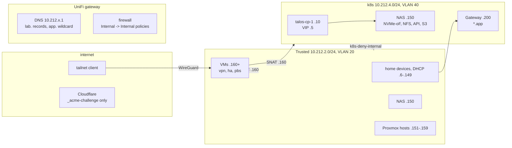
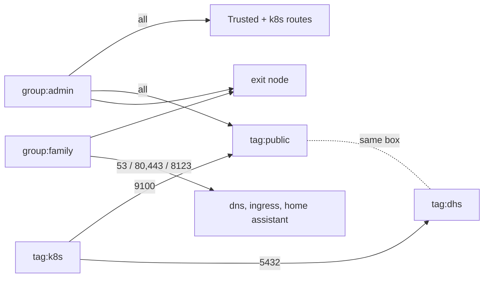

# Networking

A UniFi gateway carries five VLANs, the lab's DNS and the firewall. The
cluster is one address on its own VLAN. Remote access is Tailscale through
one VM. Nothing is published to the internet: Cloudflare holds the zone, but
only to prove domain control to Let's Encrypt.

Everything here except the VPN guest is the network layer (`network/`,
OpenTofu); build steps: [Build guide: Network](build/network/README.md).



## VLANs

| Name | CIDR | VLAN | DHCP | Holds |
|--|--|--|--|--|
| Guest (Default) | `10.212.0.0/24` | untagged | `.6-.254` | the controller's own |
| Management | `10.212.1.0/24` | 10 | `.6-.254` | network gear |
| Trusted | `10.212.2.0/24` | 20 | `.6-.149` | home devices, the NAS, Proxmox hosts, VMs |
| IoT | `10.212.3.0/24` | 30 | `.6-.254` | IoT devices, client isolation on |
| k8s | `10.212.4.0/24` | 40 | `.100-.149` | cluster nodes, the gateway address, the NAS's storage interface |

Two SSIDs: trusted and IoT. Their names come from the vault
(`wifi_trusted_ssid`, `wifi_iot_ssid`): an SSID is broadcast in the clear,
but wardriving databases tie SSIDs to coordinates and the repo is public.

**Trusted** addresses:

| Range | Holds |
|--|--|
| `.1` | gateway, resolver |
| `.6-.149` | DHCP; fixed devices (the TV) get a reservation in `unifi_clients.tf` |
| `.150` | the NAS |
| `.151-.159` | physical lab machines, static (titan `.151` ... dione `.156`) |
| `.160+` | VMs: vpn `.160`, Home Assistant `.161`, PBS `.162` |

**k8s** addresses:

| Range | Holds |
|--|--|
| `.1` | gateway, the nodes' resolver |
| `.5` | Talos VIP, the Kubernetes endpoint `k8s.<lab_domain>:6443` |
| `.10-.12` | control planes (`talos-cp-1` is `.10`) |
| `.13-.19` | workers |
| `.100-.149` | DHCP |
| `.150` | the NAS, second interface -- all storage |
| `.200` | the cluster's Gateway -- all of `<app_domain>` |
| `.201-.254` | `LoadBalancer` services, Cilium LB-IPAM |

The NAS has an interface in k8s with the same host octet so that storage never
crosses the router. Control planes `.10-.12` leave room for three without
renumbering.

## DNS

The gateway answers for the whole zone; nothing under it is in public DNS.

| Name | Points at | Written by |
|--|--|--|
| `<host>.<lab_domain>` | one `A` per machine (`nas`, `titan`, ...) | `network/unifi_dns.tf` |
| `nas-k8s`, `s3`, `s3-k8s` `.<lab_domain>` | the NAS per interface: `s3`/`nas` `.2.150`, `s3-k8s`/`nas-k8s` `.4.150` | `network/unifi_dns.tf` |
| `<vm>.<lab_domain>` | one `A` per VM | the guest's own file in `guests/` |
| `k8s.<lab_domain>` | the VIP `10.212.4.5` | `cluster/` |
| `*.<app_domain>` | `10.212.4.200` | `network/unifi_dns.tf` |

A name must exist in exactly one layer: both write the same zone through the
same controller.

The NAS has a name per interface, not one name with two addresses: that would
break half the connections, and the NAS certificate must name whichever is
dialled (all four are SANs on it).

**Cloudflare** holds the zone and nothing persistent. Proxmox, the NAS and
cert-manager prove control with DNS-01: an `_acme-challenge` TXT record that
exists for seconds. The record *name* is briefly public, and per-node
certificates land in Certificate Transparency logs -- accepted. Under
`<app_domain>` only the wildcard appears. Setup:
[Build guide: Cloudflare](build/bootstrap/cloudflare.md).

```sh
dig +short titan.<lab_domain>     # 10.212.2.151
dig +short foo.<app_domain>       # 10.212.4.200, for any name
```

## The front door {#front-door}

Every hosted service is `https://<name>.<app_domain>`, served by one
Gateway API `Gateway` (`lab`, namespace `gateway`) on `10.212.4.200`:

- one wildcard listener, one Let's Encrypt wildcard certificate
  (`*.<app_domain>`, cert-manager, DNS-01 via Cloudflare), HTTP redirected to
  HTTPS
- an app adds a hostname with one `HTTPRoute` in `flux/apps/<app>/` -- no DNS
  record, no certificate, no listener
- non-HTTP gets its own port instead: `:22000` TCP and UDP for Syncthing
  (`TCPRoute`/`UDPRoute`); any `<app_domain>` name reaches it

| Hostname | Service |
|--|--|
| `passwords` | [Vaultwarden](workloads/vaultwarden.md) |
| `sync` | [Syncthing](workloads/syncthing.md) |
| `kassenbuch` | [Kassenbuch](workloads/kassenbuch.md) |
| `supplements` | [Supplement tracker](workloads/supplement-tracker.md) |
| `dash` | [Glance](workloads/glance.md) |
| `login` | [Pocket ID](platform/pocket-id.md) |
| `bao` | [OpenBao](platform/openbao.md) |
| `registry` | [Zot](platform/zot.md) |
| `grafana`, `alertmanager` | [Monitoring](monitoring.md) |

Reachable from Trusted and the tailnet; not from the internet.

Both pieces are the platform layer: the Gateway, its namespace, the wildcard
`Certificate` and the HTTP->HTTPS redirect in `platform/platform_gateway.tf`;
cert-manager in `platform/platform_cert_manager.tf`. Wiring:
[Build guide: Platform, *The front door*](build/platform/README.md#the-front-door).

### cert-manager {#cert-manager}

Namespace `cert-manager`, one `ClusterIssuer` `letsencrypt-prod` (no staging
sibling), DNS-01 through Cloudflare with `cloudflare_api_token` -- the token
sits in `cert-manager`, because a ClusterIssuer resolves secrets in its own
namespace. The only certificate is `wildcard-app` in `gateway`, Secret
`wildcard-app-tls`. It checks its own `_acme-challenge` record against
`1.1.1.1`/`9.9.9.9` only: the gateway serves the zone privately and would
never show it.

```sh
kubectl -n gateway get certificate wildcard-app          # READY True, renewal date
kubectl -n gateway describe certificate wildcard-app
kubectl get order,challenge -A                           # while an issue is stuck
```

Production Let's Encrypt allows five certificates per week for one name set,
no appeal: on a failed first issue, read the Order and Challenge instead of
retrying. Nothing alerts on a failed renewal.

The Proxmox host and the NAS order their own certificates (Proxmox's ACME
client, TrueNAS's ACME) with the same Cloudflare token -- see
[Access & secrets, *Gotchas*](access.md#gotchas).

### Gotchas, front door

- **One wildcard for everything**: one bad renewal is every app at once.
- **`*.<app_domain>` covers one level only**: `foo.bar.<app_domain>` needs a
  second certificate.
- **`from: All`**: any namespace may attach a route; two apps claiming one
  hostname resolve oldest-wins, and the newer one just does not serve.

`10.212.4.200` is stated in four places that nothing cross-checks: the
LB-IPAM pool of one in `cluster/`, the wildcard record and the address table
in `network/`, and a note in `platform/`. The pool selects the Service
generated for `Gateway/lab` in `gateway` -- renaming the Gateway leaves it
without an address, with no error mentioning the pool.

What breaks without it: the Gateway or its certificate down is every app at
once. Infrastructure on `<lab_domain>` (Proxmox, PBS, TrueNAS) does not go
through it.

## Tailscale {#tailscale}

Remote access. SaaS control plane; the lab's side is the `vpn` VM (160), a
subnet router and exit node, tagged `tag:lab-router`. The VM itself:
[VPN VM](platform/vpn.md). Policy and DNS are tofu, in
`network/tailscale_policy.tf` and `network/tailscale_dns.tf`.

**Joining as a person**: install the Tailscale client, log in to the tailnet,
done -- the routes and split DNS apply automatically, so
`https://<name>.<app_domain>` works as at home. The exit node is optional,
picked in the client.

| What | Value |
|--|--|
| routes | Trusted `10.212.2.0/24`, k8s `10.212.4.0/24`, auto-approved for `tag:lab-router` |
| exit node | `tag:lab-router`, auto-approved; off until a client picks it |
| DNS | MagicDNS on; split DNS sends `<lab_domain>` and `<app_domain>` to `10.212.2.1` |

People are groups, machines are tags. Personal devices stay untagged and are
never a grant destination, so nothing on the tailnet can open a connection to
one. A public box carries `tag:public` (risk class, shared baseline) plus a
tag for what it runs (its own holes).

| Source | Destination | Ports |
|--|--|--|
| `group:admin` | both routes, exit node, `tag:public` | all |
| `group:family` | `lab-dns` `10.212.2.1` | tcp/udp 53 |
| `group:family` | `lab-ingress` `10.212.4.200` | tcp 80, 443; udp 443 |
| `group:family` | `home-assistant` `10.212.2.161` | tcp 8123 |
| `group:family` | exit node | all |
| `tag:k8s` | `tag:public` | tcp 9100 |
| `tag:k8s` | `tag:dhs` | tcp 5432 |

`group:admin` comes from the vault (`tailscale_admins`); `group:family` is
empty until someone joins. Nothing originates from `tag:public`, `tag:dhs` or
`tag:lab-router`. Guests by node sharing: not set up.



**Cluster egress.** The tailscale operator (namespace `tailscale`) lets the
cluster reach tailnet machines the LAN has no route to -- public boxes that
open nothing toward the lab and so must be pulled from. Egress only: nothing
in the cluster is exposed to the tailnet through it. Today that is the DHS
box (dump on 5432, scrape on 9100). A consumer gets an `ExternalName`
Service beside it, annotated `tailscale.com/tailnet-fqdn: <machine>.${tailnet_domain}`;
the operator spawns one proxy per Service, tagged `tag:k8s`. Its OAuth client
(`tailscale_operator_client_id` / `_secret`, tag `tag:k8s-operator`) is
separate from the network layer's. Wiring:
[Build guide: Tailscale](build/flux/docs/tailscale.md).

What breaks without it: no remote access (Tailscale SaaS or the `vpn` VM
down); at home nothing changes. Operator down: no DHS dump or scrape --
`DhsDown` fires.

## Firewall intent {#firewall}

The k8s VLAN runs arbitrary containers from the internet; Trusted holds the
NAS and every Proxmox management interface. So **k8s may not start a
connection into the rest of the lab**, except the scrapes below. Replies to
connections started elsewhere (ssh to a node, browsing the ingress) are
unaffected: the policies match `NEW`/`INVALID` only. Everything else between
VLANs stays open.

Internal -> Internal policies, in this order (pinned by
`unifi_firewall_zone_policy_order`; recreating them unordered once put a deny
first and cut k8s off from the NAS):

| Policy | Action | What |
|--|--|--|
| `nvmeof-deny-cross-vlan` | block | the other four networks -> `10.212.4.150:4420` |
| `s3-deny-cross-vlan` | block | Guest, Management, IoT -> Garage `:3900`/`:3903` on both NAS addresses |
| `metrics-allow-proxmox` | allow | k8s -> Proxmox hosts tcp 9100, 9221 (node- and pve-exporter) |
| `metrics-allow-home-assistant` | allow | k8s -> `10.212.2.161` tcp 8123 |
| `k8s-deny-internal` | block | k8s -> Guest, Management, Trusted, IoT |

k8s -> internet is a different zone pair and open: images, updates.

**NVMe-oF has no authentication** and `nvme connect` no TLS: reaching
`10.212.4.150:4420` is enough to attach a volume. Two things must both hold:

- the listener binds the k8s address only (set on the NAS -- see
  [Storage](storage.md))
- `nvmeof-deny-cross-vlan` blocks routed access. Needed because Trusted ->
  k8s is open by design, and the built-in allow-all would otherwise match.

The tailnet reaches k8s too, which includes `:4420`. It stays closed because
the `vpn` router SNATs to `10.212.2.160`, a Trusted address, which
`nvmeof-deny-cross-vlan` blocks. **SNAT on the router is load-bearing.**

The NAS binds SMB and ssh to Trusted only. Its web UI and API share one
listener, so the TrueNAS login page is reachable from k8s -- accepted, since
democratic-csi already holds a full-admin API key.

## Gotchas

- **macOS Sequoia: "No route to host" in a millisecond** is the per-app Local
  Network permission, not the network. `tcpdump` shows no SYN. *System
  Settings* -> *Privacy & Security* -> *Local Network*, or
  `tccutil reset LocalNetwork`.
- **`k8s-deny-internal`'s `connection_states` is ignored by tofu** (provider
  bug: written correctly, read back as null). Verify it in the UI; tofu cannot
  tell you when it drifts.
- **Never add `--snat-subnet-routes=false`** on the `vpn` VM -- see above.
- **A name in both `network/` and `guests/`** -- the two layers fight over the
  record.
