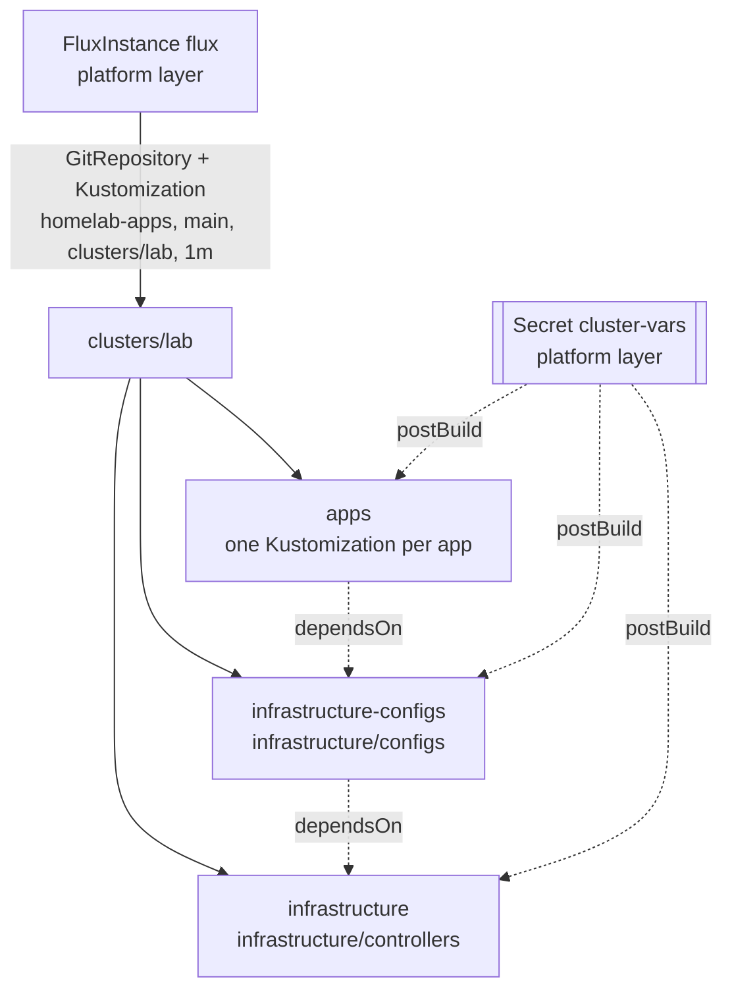

# Flux

## What it's for

GitOps: the cluster pulls the public apps repo (`Sojamann/homelab-apps`,
the `flux/` submodule here) and applies it. Merging to `main` is deploying.
Everything that must exist before Flux can reconcile, and every Secret whose
value comes from the vault, is the platform layer's instead.

## Access

- **No UI.** The `flux` CLI and `kubectl`, with `secrets/kubeconfig`.
  ```sh
  flux get kustomizations
  flux get helmreleases -A
  kubectl -n flux-system get fluxinstance flux
  ```
- **Git:** public repo, read anonymously -- no deploy key, no git credential
  anywhere.
- **Break-glass:** none needed; it has no login. When Flux is broken,
  `kubectl apply -k` a directory of `flux/` by hand -- but `${...}`
  substitution only happens in Flux, so a hand-applied manifest carries the
  literal placeholders.

## Where it runs

Namespace `flux-system`: flux-operator (Helm) plus a `FluxInstance` named
`flux`, both from `platform/platform_flux_operator.tf`. Controllers: source,
kustomize, helm, notification -- no image automation.
Build: [Build guide: Platform, *GitOps*](../build/platform/README.md#gitops),
repo layout [Build guide: Flux](../build/flux/README.md).



Each tier is `prune: true`, `wait: true`, interval 10m: a tier starts only
once the one before is healthy.

## Data

None. source-controller runs on an `emptyDir` on purpose (`spec.storage`
unset) -- a PVC would make Flux depend on democratic-csi. State is git, and
`Secret/cluster-vars` (domains, tailnet suffix, Telegram chat id), which tofu
writes.

## Backup & restore

Nothing to back up: the apps repo is on GitHub, `cluster-vars` and the
`FluxInstance` are in the platform layer. Gone: `mise run platform apply`.

**Verify.**

```sh
flux get kustomizations       # every one Ready, revision = main's HEAD
flux get sources git
```

## Admin

**Force a reconcile** instead of waiting for the interval:

```sh
flux reconcile kustomization apps --with-source
```

**Stop Flux reverting a hand change** (e.g. during a restore):

```sh
flux suspend kustomization <name>
flux resume kustomization <name>
```

Suspending `infrastructure` stops every controller in that tier, Pocket ID
included.

**Upgrades.** Two pins move together in `platform_flux_operator.tf`:
`flux_operator_version` (the chart) and `flux_version` (the distribution).
Renovate proposes both; `mise run platform apply`.

**Secrets in a public repo.** Manifests write `${app_domain}`,
`${lab_domain}`, ...; each Kustomization substitutes them from `cluster-vars`.
A new variable is a key in `platform_flux_operator.tf` and the vault. Actual
secrets go through [OpenBao](openbao.md), never `cluster-vars`.

**Moving a PVC between storage classes:** see [Storage](../storage.md#admin).

## Gotchas

- **Never rename the `infrastructure` Kustomization.** Renaming prunes its
  inventory -- the CNPG release, its CRDs and every database.
- **Substitution does not work in `clusters/lab/`** itself, only below it.
- **A prune annotation set with `kubectl annotate` is stripped.** To keep an
  object Flux would prune, set `kustomize.toolkit.fluxcd.io/prune: disabled`
  in git.
- **Changing `FluxInstance.spec.sync.name` is impossible** -- it is immutable
  and names both the GitRepository and the root Kustomization.
- **No image automation.** Own images are bumped by `mise run image`
  (see [Zot](zot.md)), public ones by Renovate.

## What breaks without it

Nothing running. Changes merged to the apps repo stop arriving, and a
hand-edited or deleted object stays that way. Tofu-managed parts (storage,
OpenBao, Gateway, cert-manager) are unaffected.
