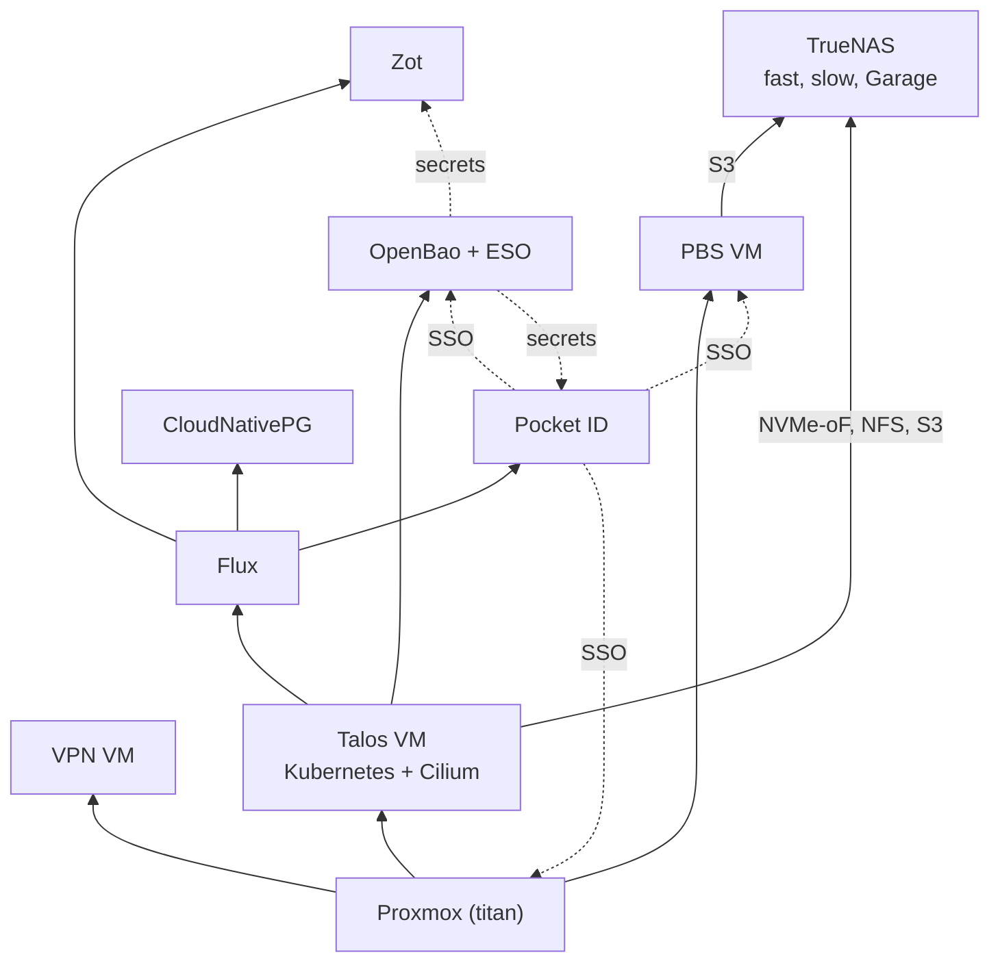

# Platform

What the workloads stand on. One page per component; each ends with what
breaks without it.

| Component | Role | Runs on | Down means |
|--|--|--|--|
| [Proxmox](proxmox.md) | hypervisor | titan, the only node | every VM: cluster, VPN, PBS, HA |
| [PBS](pbs.md) | VM backups into Garage | VM 162 on titan | no VM backups or restores |
| [TrueNAS](truenas.md) | storage, Garage S3, NAS metrics | the NAS, bare metal | every PVC, every backup, the shares |
| [Talos / Kubernetes](talos.md) | the cluster, Cilium CNI | VM 4010 on titan | every workload |
| [Flux](flux.md) | GitOps from the apps repo | ns `flux-system` | no changes applied; running things fine |
| [OpenBao + external-secrets](openbao.md) | workload secrets | ns `openbao`, `external-secrets` | no new or rotated secrets |
| [Pocket ID](pocket-id.md) | SSO (OIDC, passkeys) | ns `pocket-id` | SSO logins; break-glass logins still work |
| [Zot](zot.md) | registry for own images | ns `zot` | own apps cannot (re)pull |
| [CloudNativePG](cloudnative-pg.md) | postgres operator | ns `cnpg-system` | nothing today: no `Cluster` exists |
| [VPN VM](vpn.md) | tailnet subnet router, exit node | VM 160 on titan | no remote access |

Covered inside a topic, no page of their own:

| Component | Where |
|--|--|
| cert-manager, the Gateway (front door), Tailscale operator | [Networking](../networking.md) |
| democratic-csi, csi-driver-nfs, snapshot-controller | [Storage](../storage.md) |
| kube-prometheus-stack | [Monitoring & alerting](../monitoring.md) |
| VolSync | [Backups & restore](../backups.md#volsync) |

