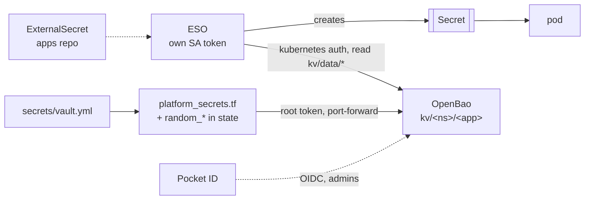

# OpenBao + external-secrets

## What it's for

The secret store for workloads. OpenBao holds every value a pod needs;
external-secrets (ESO) turns an `ExternalSecret` in the apps repo into a
Kubernetes `Secret`. The vault in `secrets/` only bootstraps the lab; how the
two fit together: [Access & secrets](../access.md).

## Access

- **UI:** `https://bao.<app_domain>`, LAN and tailnet. Method *OIDC*.
- **Login:** Pocket ID, group `admins` only (the client and the role's
  `bound_claims` both check it). Policy `admin`, everything, 8h token.
- **CLI** from a workstation:
  ```sh
  export VAULT_ADDR=https://bao.<app_domain>
  bao login -method=oidc
  bao kv get -mount=kv <ns>/<app>
  ```
- **Break-glass:** the root token, `bao_root_token` in `secrets/vault.yml`
  -- the same one tofu uses. Without the Gateway:
  `kubectl -n openbao port-forward svc/openbao 8200` and
  `VAULT_ADDR=http://127.0.0.1:8200`. The recovery keys from `bao operator
  init` are in the password managers.

## Where it runs

| | |
|--|--|
| OpenBao | ns `openbao`, StatefulSet `openbao-0`, raft, 1 replica; Helm from `platform/platform_openbao.tf` |
| ESO | ns `external-secrets`, from `platform/platform_external_secrets.tf` |
| Store | `ClusterSecretStore openbao` -> `http://openbao-active.openbao.svc:8200`, mount `kv` |
| Values | `platform/platform_secrets.tf`, one file |

Build: [Build guide: Platform, *Secrets*](../build/platform/README.md#secrets).



## Data

| What | Where | State? |
|--|--|--|
| raft: every kv value, auth config, policies | PVC `data-openbao-0`, `fast`, 1Gi | rebuildable: tofu writes all of it |
| seal key | Secret `openbao/openbao-seal`, from `random_bytes` in the platform state | **yes** -- lost = raft unreadable |
| root token | `bao_root_token` in `secrets/vault.yml` | **yes**, until re-init |
| audit log | pod stdout | no, dies with the pod |

Nothing in OpenBao is hand-entered: every value is mirrored from the vault or
generated by tofu, so the encrypted state is the backup.

## Backup & restore

Not backed up by VolSync, on purpose -- [Secrets repo](../backups.md#secrets-repo)
holds every value and the seal key. Before anything destructive, take a raft
snapshot by hand ([Other copies](../backups.md#other-copies)):

```sh
bao operator raft snapshot save ./raft-$(date +%F).snap   # logged in as above
```

**Lost volume** (or a lost `fast` pool). Re-initialise and refill:

1. Delete the PVC and pod so a fresh, empty volume comes up.
2. `bao operator init` and the second apply per
   [Build guide: Platform, *First install*](../build/platform/README.md#first-install).
   Put the **new** root token into `bao_root_token` before the apply; replace
   the recovery keys in the password managers.
3. Force the ExternalSecrets to re-read (they refresh hourly otherwise):
   ```sh
   kubectl get externalsecret -A --no-headers | while read ns name _; do
     kubectl -n "$ns" annotate externalsecret "$name" force-sync=$(date +%s) --overwrite
   done
   ```
   Then restart the apps that read their secret as env.

**Verify.**

```sh
kubectl -n openbao exec openbao-0 -- bao status        # Initialized true, Sealed false
kubectl get externalsecret -A                          # every STATUS SecretSynced
kubectl get clustersecretstore openbao                 # Valid
```

## Admin

**A new secret.** A `vault_kv_secret_v2` in `platform_secrets.tf` under
`kv/<ns>/<app>`: a `random_password` if tofu can generate it, else a variable
plus a vault key. `mise run platform apply`, then an `ExternalSecret` in the
apps repo naming the path. Workflow detail: [Access & secrets](../access.md).

**Rotating a value.** Change it in the vault (or `-replace` the
`random_password`), `mise run platform apply`, then force the sync and restart
whatever reads it as env:

```sh
kubectl -n <ns> annotate externalsecret <name> force-sync=$(date +%s) --overwrite
kubectl -n <ns> rollout restart deploy/<app>
```

**Config changes** to the server's HCL take effect only on
`kubectl -n openbao delete pod openbao-0` -- the StatefulSet updates `OnDelete`.

**The seal key.** `openbao_seal_key_id` in `platform_openbao.tf` must move
together with the key material: OpenBao records the id it sealed with, and a
mismatch is a vault that does not start. The rotation procedure itself is not
recorded.

**Upgrades.** `openbao_version` / `external_secrets_version` pins, Renovate,
`mise run platform apply`; OpenBao then needs the pod deleted (`OnDelete`).

## Gotchas

- **NotReady until initialised.** The readiness probe runs `bao status`; a
  fresh install is legitimately NotReady, which is why the first apply does not
  wait for it.
- **It unseals itself** (`seal "static"`): the key sits next to the lock, and
  RBAC on one Secret is the whole control.
- **ESO reads the whole tree.** Anything that can create an `ExternalSecret`
  in any namespace can read any secret.
- **Read-only by design.** PushSecret is disabled; the store's
  `status.capabilities` still says `ReadWrite` -- ESO derives that from the
  provider type.
- **Audit fails closed** -- hence stdout, not a file on the data volume.
- **`platform apply` needs OpenBao up**: `scripts/tofu.sh` port-forwards to
  `svc/openbao` and configures it with the root token.

## What breaks without it

OpenBao down: no new or rotated secrets. Existing `Secret`s stay, so running
pods are fine; a new app or a recreated namespace waits for its Secret, and
`mise run platform apply` fails. ESO down: same, plus nothing re-syncs. Lost
seal key: the raft volume is unreadable -- re-initialise as above.
