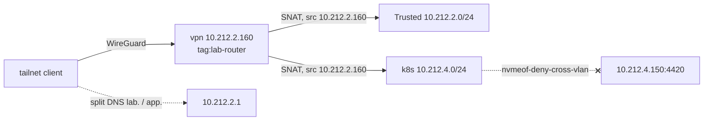

# VPN VM

## What it's for

Remote access. VM `vpn` is the Tailscale subnet router and exit node: tailnet
clients reach Trusted (`10.212.2.0/24`) and k8s (`10.212.4.0/24`) through it.
Tailscale itself is SaaS; the policy, groups and DNS are the network layer's
-- see [Networking](../networking.md). The cluster's own Tailscale operator
(egress to public boxes) is a separate thing and does not use this VM.

## Access

- **SSH:** from Trusted or the tailnet:
  ```sh
  ssh -i secrets/guests-ssh-key ubuntu@vpn.<lab_domain>
  ```
  The key is written by the guests layer (gitignored; `mise run guests
  apply` writes it again).
- **Tailscale admin console:** SaaS; the node appears as `vpn`, tag
  `tag:lab-router`. Login via GitHub.
- **Break-glass:** the VM 160 console in Proxmox. User `ubuntu` has no
  password (cloud-init sets only the key), so a console login without the key
  is not possible -- restore from PBS instead.

## Where it runs

VM 160 on titan, `10.212.2.160`, MAC `BC:24:11:00:01:60`, Ubuntu 24.04 cloud
image, 2 cores (WireGuard is CPU-bound per flow), 2G, 16G disk.
`guests/guest_vm_vpn.tf`; Tailscale installed by hand.
Build: [Build guide: Guests, *VPN*](../build/guests/README.md#vpn).



## Data

Only the node's Tailscale identity (`/var/lib/tailscale`). Rebuildable: a new
auth key and a re-join. Routes and the exit node approve themselves through
the policy's `autoApprovers` for `tag:lab-router`; a tagged node's key does
not expire.

## Backup & restore

[PBS](../backups.md#pbs), nightly. Restoring the VM keeps the Tailscale
identity. Restore steps: [Backups: PBS](../backups.md#pbs), VM id 160.

**Or rebuild:** `mise run guests apply` (or `-replace` the VM), then the
install-and-join steps in [Build guide: Guests, *VPN*](../build/guests/README.md#vpn)
with a new one-off, pre-approved auth key tagged `tag:lab-router`. Remove the
old `vpn` machine in the admin console first, or the new one gets a suffixed
name.

**Verify.** From a tailnet client off the LAN:

```sh
tailscale status | grep vpn
ping 10.212.2.150                  # NAS, via the route
dig passwords.<app_domain>         # split DNS answers
```

## Admin

**Updates.** By hand: `apt update && apt full-upgrade` on the guest (OS and
Tailscale packages). Nothing automates them.

**Cloud-init file** is still named `netbird-cloud-init.yaml`: a new file name
would be a new `user_data_file_id`, which replaces the VM.

## Gotchas

- **Never add `--snat-subnet-routes=false`.** The SNAT to `10.212.2.160` (a
  Trusted address) is what lets `nvmeof-deny-cross-vlan` keep the tailnet off
  the NVMe-oF listener.
- **`--accept-dns=false`**: the guest already resolves through the gateway;
  split DNS would only point it back there.
- **IP forwarding** comes from `/etc/sysctl.d/99-tailscale.conf`, written by
  hand at install. A rebuild without it routes nothing.
- **Hostname**: cloud-init set it once from the old name; `hostnamectl
  set-hostname vpn` is part of the install.

## What breaks without it

No remote access to the lab: tailnet clients reach nothing at home, and the
exit node is gone. On the LAN everything works. The cluster's Tailscale
operator (DHS dumps, scrapes of public boxes) is unaffected.
