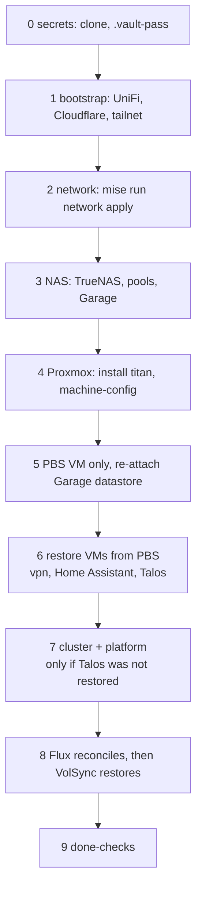

# Recover from zero

The order to bring the lab back in, what you need before you start, and when
each backup is restored. The steps themselves live on the linked pages.

Not every disaster is this one. Something narrower broke: the
[scenario index](backups.md#scenario-index). The NAS is gone: there is no
recovery yet -- see [Not covered](backups.md#not-covered).

**Last verified:** never, end to end.

## Have in hand

Without the first three, stop: nothing below works.

| What | Why | If lost |
|--|--|--|
| **The vault password** (`secrets/.vault-pass`) | unlocks `vault.yml`, which holds the state passphrase -- every layer | everything in `secrets/` is unreadable; second copy: the password managers |
| **GitHub login** with access to `Sojamann/homelab` and the private `Sojamann/homelab-secrets` | the code, the vault, the encrypted tofu state | -- |
| **A workstation** with `mise` (and Docker, for hashing tools) | every layer runs from here | [Build guide: Workstation](build/bootstrap/workstation.md) |
| Vendor logins: UniFi controller, Tailscale (via GitHub), Cloudflare | re-adopting gear, re-joining the router, if the zone or tokens are gone | not in the repo |
| Local root/admin passwords: Proxmox and PBS `root@pam`, TrueNAS `admin` / `truenas_admin` | installs, break-glass | the password managers -- see [break-glass](access.md#break-glass) |
| The ZFS pool passphrase | unlocks `fast` and `slow` after a TrueNAS reinstall | the password managers |
| Home Assistant's backup encryption key | without it its own backups are unreadable | the password managers |
| OpenBao recovery keys, Vaultwarden admin token plaintext, Kassenbuch password | admin of those apps | the password managers |
| **The off-site key** | -- | off-site is not built; nothing to have yet |

Second copies of all of these are kept in several password managers, not
only the lab's Vaultwarden.

## The order

Each stage depends on the ones before. "Restore" in the right column is when
the backup comes back -- earlier fails, later loses data or doubles work.



| # | Stage | How | Restore here |
|--|--|--|--|
| 0 | **Secrets** | `git clone --recurse-submodules`, put the vault password at `secrets/.vault-pass` (0600), `mise install` | [Secrets repo](backups.md#secrets-repo): this *is* the restore |
| 1 | **Bootstrap** | only what is gone: gateway adopted, Cloudflare zone + token, tailnet + OAuth client. [Build guide: Bootstrap](build/bootstrap/README.md) | -- |
| 2 | **Network** | `mise run network apply`: VLANs, DNS, firewall, wifi, tailnet policy. [Build guide: Network](build/network/README.md) | -- (state is in `secrets/`) |
| 3 | **NAS** | if it survived: nothing. Boot disk (eMMC) dead, pools intact: reinstall TrueNAS, import both pools, unlock with the passphrase. Else TrueNAS, pools, datasets, shares, Garage, node-exporter -- [Build guide: TrueNAS](build/machines/truenas.md). Garage must answer before stage 5 | a rebuilt NAS has no backups: [Not covered](backups.md#not-covered) |
| 4 | **Proxmox** | install titan, ssh key, `pvecm create lab`, then `mise run machine-config` -- [Build guide: Proxmox](build/machines/proxmox.md), [machine-config](build/machine-config/README.md) | -- (host config is rebuilt, not restored) |
| 5 | **PBS** | `mise run guests apply -target=proxmox_virtual_environment_vm.pbs` **only**, install PBS, re-add the Garage endpoint and datastore on the existing bucket | [PBS, *Dead node*](backups.md#pbs) |
| 6 | **VMs from PBS** | restore 160 (vpn), 161 (Home Assistant), 4010 (Talos) under their own ids; then `mise run guests plan` -- close to a no-op | [PBS](backups.md#pbs). Home Assistant: if its PBS copy is bad, a fresh VM + [its own backups](backups.md#ha-backups) |
| 7 | **Cluster + platform** | Talos VM restored: skip to 8. Else `mise run guests apply`, `mise run cluster apply`, then the OpenBao two-step from [Build guide: Platform, *First install*](build/platform/README.md#first-install) and `mise run platform apply` | [etcd](backups.md#etcd-snapshots), only if a snapshot exists, *before* the cluster layer bootstraps etcd |
| 8 | **Flux** | the platform layer installs Flux; it reconciles `infrastructure`, `infrastructure-configs`, `apps` in that order -- `flux get kustomizations` | [VolSync](backups.md#volsync), per PVC, once Flux is Ready -- see below |
| 9 | **Done-checks** | below | -- |

Why this order:

- **PBS before every VM** -- the VMs are restored *from* it, and a full
  `guests apply` would create empty VMs under the ids the restores need.
- **The NAS before Proxmox** -- PBS's datastore and every PVC are on it.
- **Home Assistant from PBS, not its own backups**, when PBS has it: the VM
  comes back whole. Its own backups are for a fresh or broken instance.
- **VolSync after Flux has reconciled** -- the restore writes into the PVC
  Flux creates, needs the ExternalSecret with the restic credentials (OpenBao
  must be filled, stage 7), and the VolSync controller (`infrastructure`).
- **The Talos VM from PBS** brings etcd back as of 23:00 that day, with every
  PVC still on the NAS. Usually the faster path; see the caveat on
  [PBS](backups.md#pbs).

## Stage 7 and 8 on a fresh cluster

Only when the Talos VM could not be restored.

**OpenBao** starts empty: re-initialise it, put the new root token in
`secrets/vault.yml` as `bao_root_token`, the new recovery keys in the password
managers, then `mise run platform apply` refills every value from the vault and
state. Commit with `mise run save`. See [OpenBao](platform/openbao.md).

**`fast` PVCs** come up empty. Restore each one that has a backup with the
generic [VolSync restore](backups.md#volsync), values from its page:

| Order | PVC | Page | Note |
|--|--|--|--|
| 1 | `pocket-id-state` | [Pocket ID](platform/pocket-id.md) | first: SSO for Grafana, OpenBao, Proxmox, PBS. Its Kustomization is `infrastructure` -- suspending it pauses every controller |
| 2 | `vaultwarden-data` | [Vaultwarden](workloads/vaultwarden.md) | |
| 3 | `syncthing-config` | [Syncthing](workloads/syncthing.md) | device keys: without them every device re-pairs |
| -- | `postgres-dump` | [DHS](workloads/dhs.md) | nothing to restore: it is a staging copy, the history stays in restic |

**Restore as of before the rebuild.** Flux creates each ReplicationSource
with the app, and its first run starts at creation -- it backs up the new,
empty PVC, which becomes restic's `latest`. Set `restoreAsOf` in the
ReplicationDestination to a time before the lab went down, or check with
`restic snapshots` ([without the cluster](backups.md#volsync)) which
snapshot is the real one. Do the restores as soon as Flux is Ready, before
anyone uses the fresh apps.

**`bulk` PVCs** (Kassenbuch, Supplement tracker, Zot) are recreated as new,
empty `pvc-<uuid>` directories under `slow/k8s-csi`. The old directories are
still there: scale the app to 0, copy the old directory's contents into the
new one on the NAS, scale up -- as in
[ZFS snapshots, *Restore*](backups.md#zfs-snapshots) with the live directory
as source. Zot can instead be refilled by pushing the images again.
Syncthing's files are a static PV onto `slow/k8s-csi/syncthing` and need
nothing.

**Not restored, rebuilt:** Prometheus and Alertmanager history (gone),
Grafana (stateless), Glance (stateless), OpenBao (from tofu), CloudNativePG
(no databases).

## How to tell you're done

```sh
for l in network guests cluster platform; do mise run $l plan; done   # each: no changes
flux get kustomizations                     # every one Ready
kubectl get pods -A | grep -v -E 'Running|Completed'
kubectl get replicationsource -A            # every LAST SYNC within a day, from tomorrow
pvesm list pbs-s3 | tail                    # tonight's 23:00 run is there tomorrow
```

- Alertmanager shows only `Watchdog`; Cronitor shows pings arriving; a test
  alert reaches Telegram -- see [Monitoring](monitoring.md#backup--restore).
- The Grafana *Lab* dashboard is all green.
- Each workload's *Verify* steps pass:
  [Workloads](workloads/index.md).
- From the tailnet, away from home: `https://passwords.<app_domain>` loads
  ([Networking](networking.md#tailscale)).
- Pocket ID login works on Grafana, OpenBao, Proxmox and PBS.
- `git status` and `git -C secrets status -sb` clean and pushed -- the new
  root token and any regenerated state are backed up.
- Update **Last verified** on every route you restored.
