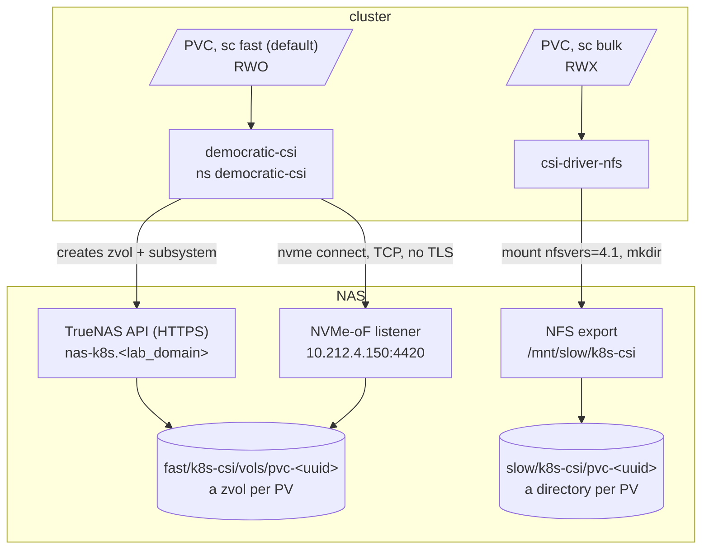

# Storage

Three places data sits, chosen by redundancy against speed:

| Tier | Where | Media | Redundancy | For |
|--|--|--|--|--|
| `fast` | NAS pool `fast` | 1x NVMe 500GB, encrypted | **none** | latency-bound PVCs: databases, indexes, OpenBao, Prometheus |
| `slow` | NAS pool `slow` | 2x 4TB HDD, one mirror, ~4TB usable, encrypted | 1 disk | `bulk` PVCs, people's files, every backup |
| `local` | each Proxmox node's own disk | node disk | none | VM disks (qcow2), ISOs, images |

Kubernetes sees two StorageClasses on the NAS, `fast` and `bulk`. Everything
reaches the NAS over its k8s interface `10.212.4.150`, so no storage traffic
crosses the router. Backups of all of it: [Backups & restore](backups.md).



## What lives where

| What | Tier | Size | Backed up by |
|--|--|--|--|
| `vaultwarden-data` | `fast` | 1Gi | VolSync |
| `syncthing-config` | `fast` | 2Gi | VolSync |
| `pocket-id-state` | `fast` | 1Gi | VolSync |
| `postgres-dump` (DHS) | `fast` | 5Gi | VolSync |
| `data-openbao-0` | `fast` | 1Gi | rebuilt by tofu |
| Prometheus | `fast` | 20Gi (capped at 18GB, 30d) | not kept |
| Alertmanager | `fast` | 1Gi | not kept |
| `syncthing-data` -> `slow/k8s-csi/syncthing` | `bulk`, static PV | 1Ti (label only) | ZFS snapshots |
| `kassenbuch-data` | `bulk` | 10Gi | ZFS snapshots |
| `supplement-tracker-data` | `bulk` | 1Gi | ZFS snapshots |
| `zot-data` | `bulk` | 20Gi (label only) | ZFS snapshots |
| `slow/users/<name>/files` | `slow`, SMB per person | -- | ZFS snapshots |
| `slow/users/<name>/time-machine` | `slow`, SMB, quota | -- | none, by design |
| `slow/garage` | `slow`, Garage S3, quota 1T | -- | ZFS snapshots, 7d |
| `slow/ha-backups` | `slow`, SMB, quota | -- | ZFS snapshots, 14d |
| `slow/node-exporter` | `slow` | -- | none, rewritten every minute |
| VMs 160, 161, 162, 4010 | `local` on titan | 16G / 32G / 20G+8G / 40G | PBS (not 162) |

`bulk` sizes are labels: NFS enforces no quota, the whole `slow` pool is the
limit. On `fast`, `zvolEnableReservation` reserves each zvol's full size, so
the pool cannot be oversubscribed.

## Where it runs

All three drivers are the platform layer, Helm releases in tofu, single
replica (one node), namespaces labelled `privileged` (the node plugins mount
the host and `/dev`):

| Component | Namespace | Defined in |
|--|--|--|
| democratic-csi (`org.democratic-csi.nvmeof`) | `democratic-csi` | `platform/platform_democratic_csi.tf` |
| csi-driver-nfs | `csi-driver-nfs` | `platform/platform_csi_nfs.tf` |
| snapshot-controller (VolumeSnapshot CRDs + controller, shared) | `snapshot-controller` | `platform/platform_snapshot_controller.tf` |

Wiring: [Build guide: Platform, *Storage*](build/platform/README.md#storage).
The NAS half (pools, datasets, NVMe-oF listener, NFS export, API key) is
[TrueNAS](platform/truenas.md) and
[Build guide: TrueNAS](build/machines/truenas.md).

The full `slow` dataset tree, with recordsize, compression and ACLs, is built
in [Build guide: TrueNAS](build/machines/truenas.md#creating-datasets).

## `fast`: democratic-csi {#fast}

Default StorageClass. A PVC becomes a zvol, `fast/k8s-csi/vols/pvc-<uuid>`,
exposed as an NVMe-oF subsystem (prefix `csi-`) on the existing listener; the
node connects over TCP and formats it `ext4`. `WaitForFirstConsumer`,
expansion allowed. Every driver action is an API call -- no ssh to the NAS.

- **API by name** (`https://nas-k8s.<lab_domain>`), verified against the NAS's
  ACME certificate. A TLS error means a missing SAN, never a reason to turn
  verification off.
- **Data path by address** (`10.212.4.150:4420`): `nvme connect` is on the
  volume-attach path, and DNS there would make a pod depend on DNS for its
  disk.
- **Credential**: `truenas_api_key`, bound to a dedicated `democratic-csi` NAS
  user with `FULL_ADMIN` -- the only role TrueNAS lets through its REST API.
  No expiry; an expired or revoked key shows as PVCs stuck `Pending`.
- **Port id** `truenas_nvmeof_port_id` in `platform/platform_democratic_csi.tf`
  is a fact from the NAS: the driver attaches to existing ports, it does not
  create them.

The driver owns everything under `fast/k8s-csi` (`create_ancestors` on the
first PVC): no datasets, subsystems or snapshot tasks are made by hand there.

### Snapshots

`VolumeSnapshot` is not part of Kubernetes: snapshot-controller installs the
CRDs and the controller, and without it the kind does not exist. The
two democratic-csi knobs differ on purpose:

| | Snapshot (`detachedSnapshots`) | Restore (`detachedVolumesFromSnapshots`) |
|--|--|--|
| set to | `false` | `true` |
| mechanism | `zfs snapshot` | `zfs send \| recv` |
| cost | instant, ~0 bytes | slow, full size |

Cheap snapshots, so one before something destructive is free. Detached
restores because a `zfs clone` pins its origin: snapshot PVC-A, restore as
PVC-B, and deleting PVC-A fails with `filesystem has dependent clones` -- a
PVC stuck `Terminating` with nothing in Kubernetes saying why.

**But the detached restore fails on this pool**: `fast` is encrypted, and
TrueNAS refuses the driver's `send | recv` (*"Destination dataset must be
encrypted"*), so a PVC from a VolumeSnapshot stays `Pending`. Snapshots
themselves work; a rollback is `zfs rollback` on the NAS. VolSync avoids it
with plain clones and `Direct` restores -- see
[VolSync](backups.md#volsync).

A snapshot pins every block the live volume overwrites. Nothing prunes them:
a forgotten one on a write-heavy PVC fills the pool.

## `bulk`: csi-driver-nfs {#bulk}

One NFS export, `10.212.4.150:/mnt/slow/k8s-csi`, mounted `nfsvers=4.1,hard`
(a NAS reboot blocks IO instead of handing pods `EIO`). The driver `mkdir`s
one directory per PV and has no API to the NAS, which is why the dataset
`slow/k8s-csi` is made by hand. `Immediate` binding, RWX.

- **No `VolumeSnapshotClass`.** The driver would snapshot by writing a tarball
  into the share -- a second full copy inside the dataset the NAS already
  snapshots. The ZFS task on `slow/k8s-csi` is the mechanism, and nothing in
  the cluster knows about it.
- **`no_root_squash`.** The driver and the kubelet (`fsGroup`) both `chown` as
  root on the mount; squashed, the volume mounts and the pod cannot write. So
  anything that can reach `10.212.4.150` on k8s is root on the share.
- **Syncthing's files are a static `Retain` PV** onto `slow/k8s-csi/syncthing`,
  made by hand, so no PVC delete can take them. See
  [Syncthing](workloads/syncthing.md).

## Admin

**Choosing a class.** `fast` for anything latency-bound or SQLite-on-a-block-
device; it needs a `backup.yaml` if it cannot be rebuilt. `bulk` for what must
sit on the mirror outright, or what several pods share.

**Moving a PVC between classes.** `storageClassName` is immutable, so copy:
scale the app to 0 and suspend its Kustomization, copy into a new PVC, then
two pushes -- first switch the app to the new PVC while keeping the old one
in git with the annotation `kustomize.toolkit.fluxcd.io/prune: disabled`, then
drop it from git and delete it by hand. Set the annotation in git, not with
`kubectl annotate`: Flux strips it and prunes the PVC with its data.

**Growing a `fast` PVC.** Raise `resources.requests.storage` in its
`storage.yaml`; expansion is online.

**Capacity.**

- `slow`: stay under 80% (~3.2TB); `NasPoolFull` warns above it. Grow by
  adding a **second mirror vdev** in the two free bays (8TB usable), never by
  widening one.
- `fast`: the single 500GB NVMe. Mirror it later with `zpool attach` / UI
  *Extend*, **never** `zpool add` (that stripes, and loses everything when
  either drive dies). A scrub on `fast` can only report, not repair: an error
  there means buy the second M.2 that week.
- Scrubs: both pools, weekly task with a 30-day threshold, so monthly.
- SMART tests: **not set up**. Intended: short weekly, long monthly.

```sh
kubectl get pvc -A
# NAS shell (UI System -> Shell):
zpool list
zfs list -o name,used,avail,refer -r slow -d 2
```

## What breaks without it

- **NAS down** -- every PVC: `fast` pods lose their disk (IO errors,
  read-only remounts), `bulk` pods block on `hard` NFS until it is back.
  OpenBao, Pocket ID and Prometheus are on `fast`, so it is effectively the
  whole cluster. VM disks are on `local` and keep running, but PBS has no
  datastore.
- **`fast` NVMe dead** -- every `fast` PVC gone; see
  [VolSync, *Lost `fast` pool*](backups.md#volsync).
- **democratic-csi down** -- running pods keep their volumes; new `fast` PVCs
  stay `Pending`, deletes hang. Same for csi-driver-nfs and `bulk`.
- **snapshot-controller down** -- no new VolumeSnapshots; VolSync is
  unaffected (it clones).
- **TrueNAS API key expired or revoked** -- same as democratic-csi down.

## Gotchas

- **`reclaimPolicy: Delete` on both classes.** `kubectl delete pvc` destroys a
  `fast` zvol immediately -- only a VolSync backup survives it. A deleted
  `bulk` directory survives in the `slow/k8s-csi` snapshots for 30 days.
- **A recreated `bulk` PVC is a new, empty directory.** The old data stays in
  the old `pvc-<uuid>` directory (or its snapshots) and has to be copied over.
- **Never snapshot `fast` outside the driver.** A ZFS snapshot it does not
  know blocks the zvol destroy, and the PVC sits `Terminating`.
- **Recreating the NVMe-oF port changes its id**: volumes then provision and
  never attach, with no error mentioning a port. Edit the port (`PUT`), don't
  recreate it -- see [Build guide: TrueNAS](build/machines/truenas.md#shares-and-services).
- **The NAS apps pool is `slow`**, never `fast`, which the driver owns.
- **Both pools are encrypted**; the passphrase is in the password managers.
  After a TrueNAS reinstall the pools import locked until it is entered.
