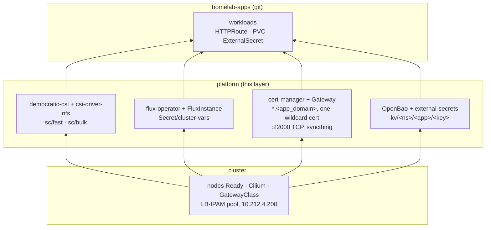

# Platform

What a workload assumes exists. [cluster](../cluster/README.md) leaves a
working but barebones Kubernetes: nodes Ready, a CNI, and an address pool. It
cannot run anything with state.

This layer adds the capabilities on top of that: storage, GitOps, the front
door and the secret store, and the same place policy will go. The line it
draws is **capability, not workload**: democratic-csi, flux, cert-manager, the
Gateway and openbao belong here.

How each piece works and is restored: [Storage](../docs/src/storage.md),
[Flux](../docs/src/platform/flux.md),
[OpenBao + external-secrets](../docs/src/platform/openbao.md),
[Networking, front door](../docs/src/networking.md#front-door).



## Running

```sh
mise run platform plan
mise run platform apply
```

Arguments are forwarded to `tofu`. `init` runs automatically on first use.

## Credentials

Read out of the ansible vault by `scripts/tofu.sh` and exported. None is
Proxmox or UniFi -- this layer talks to the cluster, to the NAS and to OpenBao,
and to nothing else in the lab. The Telegram, heartbeat, Kassenbuch,
Vaultwarden and Grafana values it only carries: they are written into OpenBao and
`cluster-vars` for the apps, and nothing here dials them.

| Variable                              | Source              | For                                   |
|---------------------------------------|---------------------|---------------------------------------|
| `TF_VAR_truenas_api_key`              | `secrets/vault.yml` | democratic-csi -> TrueNAS API         |
| `TF_VAR_cloudflare_api_token`         | `secrets/vault.yml` | cert-manager's DNS-01 solver          |
| `TF_VAR_terraform_state_passphrase`   | `secrets/vault.yml` | this layer's encrypted state          |
| `TF_VAR_lab_domain`                   | `secrets/vault.yml` | the NAS's name                        |
| `TF_VAR_app_domain`                   | `secrets/vault.yml` | what the gateway serves               |
| `TF_VAR_acme_email`                   | `secrets/vault.yml` | the Let's Encrypt account             |
| `TF_VAR_telegram_bot_token`           | `secrets/vault.yml` | Alertmanager -> Telegram              |
| `TF_VAR_telegram_chat_id`             | `secrets/vault.yml` | the group it posts into               |
| `TF_VAR_heartbeat_url`                | `secrets/vault.yml` | the `Watchdog` heartbeat              |
| `TF_VAR_kassenbuch_password_hash`     | `secrets/vault.yml` | Kassenbuch's login                    |
| `TF_VAR_vaultwarden_admin_token_hash` | `secrets/vault.yml` | Vaultwarden's `/admin`                |
| `TF_VAR_garage_metrics_token`         | `secrets/vault.yml` | Prometheus -> Garage's `/metrics`     |
| `TF_VAR_grafana_oidc_client_id`       | `secrets/vault.yml` | Grafana's Pocket ID client            |
| `TF_VAR_grafana_oidc_client_secret`   | `secrets/vault.yml` | its secret                            |
| `TF_VAR_bao_oidc_client_id`           | `secrets/vault.yml` | OpenBao's Pocket ID client            |
| `TF_VAR_bao_oidc_client_secret`       | `secrets/vault.yml` | its secret                            |
| `TF_VAR_tailscale_operator_client_id` | `secrets/vault.yml` | the tailscale operator's OAuth client |
| `TF_VAR_tailscale_operator_client_secret` | `secrets/vault.yml` | its secret                        |
| `TF_VAR_tailnet_domain`               | `secrets/vault.yml` | `cluster-vars`, tailnet names         |
| `TF_VAR_dhs_backup_user`              | `secrets/vault.yml` | DHS's postgres backup role            |
| `TF_VAR_dhs_backup_password`          | `secrets/vault.yml` | its password                          |
| `VAULT_TOKEN`                         | `secrets/vault.yml` | `bao_root_token`, configuring OpenBao |

> [!NOTE]
> the terraform state is committed and encrypted.

The cluster itself is reached through `secrets/kubeconfig`, written by the
cluster layer. There is no credential for it here.

`VAULT_ADDR` is not a credential and not in the vault: `scripts/tofu.sh` opens
a port-forward to `svc/openbao` and points it at loopback. OpenBao is the one
thing here this layer configures over its own API rather than only installing.

## First install

OpenBao cannot be installed and configured in one pass -- the token that
configures it does not exist until it is running. Once per cluster:

```sh
mise run platform apply -target=helm_release.openbao
kubectl -n openbao exec -it openbao-0 -- bao operator init -format=json
mise run platform apply
```

The root token goes in `secrets/vault.yml` as `bao_root_token`. The recovery
keys go in a password manager.

## The front door

One `Gateway` on one wildcard listener behind one wildcard certificate, so
adding a hostname is an `HTTPRoute` in the apps repo and nothing here. The
address is not requested: [cluster](../cluster/README.md) holds `10.212.4.200`
in a LB-IPAM pool of one selected onto this Gateway's generated Service, and
[network](../network/README.md) points the `app.` wildcard record at it. Three
layers therefore agree on the name `Gateway/lab` in namespace `gateway`, and
nothing checks that they still do.

A non-HTTP protocol gets its own port instead: a TCP or UDP listener has no
hostname, so the port alone is the match, and each is open to one namespace.
Today that is `:22000` TCP and UDP for syncthing (`TCPRoute` and `UDPRoute` in
the apps repo). Any `app.` name reaches it, which saves a DNS record and costs
nothing a port number would not.

## Secrets

OpenBao (`platform_openbao.tf`) and external-secrets. How it unseals, who reads
what, rotation and restore: [OpenBao](../docs/src/platform/openbao.md).
Every value lives in one file, `platform_secrets.tf`, under
`kv/<namespace>/<app>/<key>` -- mirrored from the ansible vault or generated by
tofu.

People log in through Pocket ID (OIDC auth at `oidc/`, group `admins`). Its
Pocket ID client is confidential, PKCE off, with two callbacks:
`https://bao.<app_domain>/ui/vault/auth/oidc/oidc/callback` and
`http://localhost:8250/oidc/callback`.

## Storage

Two classes, `fast` (democratic-csi, NVMe-oF zvols on the `fast` pool) and
`bulk` (csi-driver-nfs, directories under `slow/k8s-csi`), plus
snapshot-controller for the `VolumeSnapshot` CRDs. How they work, the snapshot
parameters and their failure modes: [Storage](../docs/src/storage.md).

The NAS half is built by hand in [machines/truenas.md](../machines/truenas.md),
including the NVMe-oF port id this layer hardcodes
(`truenas_nvmeof_port_id`). The driver creates everything under
`fast/k8s-csi` itself, with `create_ancestors`, on the first PVC;
`fast/k8s-csi/snaps` is required configuration even though it stays empty --
the driver refuses to start without it, or if it overlaps the volumes dataset.

## GitOps

Flux comes in two pieces and both are here: the flux-operator chart, and the
`FluxInstance` that makes it install actual controllers. The layer ends with a
cluster pulling from git. What tofu owns versus git, `cluster-vars`, and why
there is no image automation: [Flux](../docs/src/platform/flux.md).

```sh
flux get kustomizations
kubectl -n flux-system get fluxinstance flux
```

## Known trade-offs

Operational ones are on the topic pages' *Gotchas*. Left here, the ones about
how this layer is built:

- **Capabilities here do not self-heal.** Flux reverts a hand-edited object
  within its interval; tofu notices at the next `plan`, which is whenever you
  run one.
- **The apps repo publishes the topology.** Chart names and pinned versions are
  the manifests and cannot be substituted away, so what runs here and at which
  version is public even though the addresses are not.
